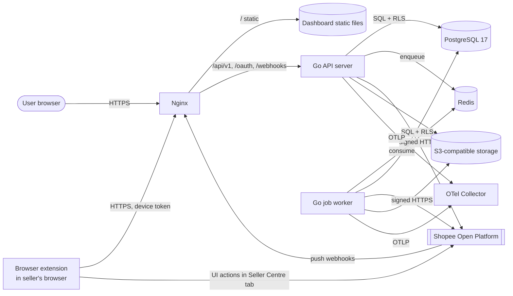
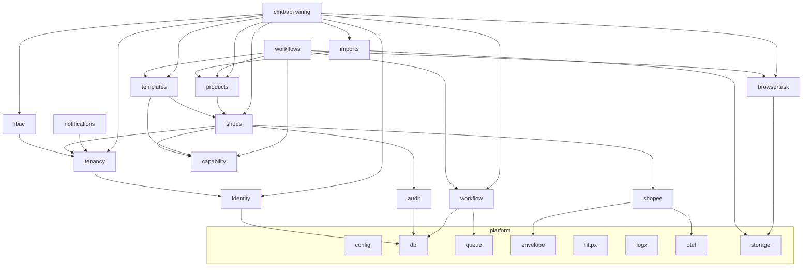

# Architecture — Shopee Shop Automation

Status: Phase 0 draft · Last updated: 2026-10-30

## 1. Summary

A **modular monolith** in Go with three deployable processes built from one codebase, plus a browser extension that runs in the seller's own browser and a static Vue dashboard.

| Process | Binary | Responsibility |
|---|---|---|
| API server | `cmd/api` | REST API `/api/v1`, Shopee OAuth callback, Shopee webhook receiver, extension API `/api/v1/ext` |
| Job worker | `cmd/worker` | Asynq consumer: workflow steps, token refresh, shop sync, import parsing, webhook processing |
| Scheduler | `cmd/worker --scheduler` | Asynq periodic tasks and the workflow "sweeper" (re-enqueues stuck steps). Runs as a single replica. |
| Migrator | `cmd/migrate` | Applies SQL migrations as the schema owner role |
| Browser extension | `browser-extension/` (MV3, WXT + TypeScript) | Executes `BROWSER` capabilities in the seller's logged-in Seller Centre tab. See [browser-extension.md](browser-extension.md) |
| Dashboard | `web/` (Nuxt 3, SPA mode) | Static build served by Nginx |



## 2. Architecture decisions

Each decision is short; it can be promoted to a full ADR file if challenged.

### ADR-1 Modular monolith

One Go module, packages per bounded context, enforced dependency rules (§4). Scaling happens by running more `api` and `worker` replicas, which are stateless. A module is extracted into a service only when it has a different scaling or isolation profile that we can measure. The browser worker is already separate because it needs a different runtime and a stronger sandbox.

### ADR-2 sqlc + pgx, not GORM

RLS, composite foreign keys, `FOR UPDATE SKIP LOCKED`, advisory locks and JSONB queries are central to correctness here. sqlc keeps SQL explicit and type-checked. Driver: `pgx/v5` with `pgxpool`. Migrations: `goose` (plain SQL files, up/down).

### ADR-3 Frontend: Nuxt 3 in SPA mode, not Inertia.js

The master spec requires a documented REST API with OpenAPI. The dashboard should consume **that same API**, so there is one contract, generated TypeScript types (`openapi-typescript`) and one set of authorization checks.

- Inertia would add a second contract (server-rendered page props) next to the REST API, and Go has only small community Inertia adapters.
- Nuxt with `ssr: false` produces static files. No Node server runs in production for the dashboard. Nginx serves them on the same origin as the API, so cookies stay `SameSite=Strict`-friendly and no CORS is needed.
- Nuxt gives file-based routing, layouts and route middleware for auth guards; shadcn-vue, Tailwind and Pinia all support it.

(An earlier chat suggestion favored Inertia; this decision supersedes it after reading the full spec.)

### ADR-4 Authentication: server-side sessions

Opaque random session ID (256-bit) in an `HttpOnly; Secure; SameSite=Lax` cookie. Session rows live in PostgreSQL (`user_sessions`), hashed, with idle (12 h) and absolute (7 days) expiry and a Redis cache. CSRF: synchronizer token returned by `GET /api/v1/auth/session` and required in `X-CSRF-Token` on every unsafe method. JWTs are not used: revocation and "log out everywhere" are simpler with server sessions.

### ADR-5 Tenant in the URL path

Tenant-scoped routes are `/api/v1/orgs/{orgId}/...`. Middleware loads the membership for `(user, orgId)`; no membership → `404` (not `403`, to avoid leaking existence). The resolved `TenantContext{OrgID, UserID, Role, Permissions}` is put on `context.Context`. Handlers never read an org ID from a body.

### ADR-6 Defense in depth with PostgreSQL RLS

- The application connects as role `app_rw`, which is **not** the table owner and does **not** have `BYPASSRLS`. Every tenant table has `ENABLE` + `FORCE ROW LEVEL SECURITY`.
- Every transaction that touches tenant data starts with `SELECT set_config('app.org_id', $1, true)` (transaction-local). The policy is `org_id = current_setting('app.org_id', true)::uuid`. If the setting is missing, the comparison is `NULL`, so **no rows are visible** (fail closed).
- Child tables carry `org_id` too and use **composite foreign keys** `(org_id, parent_id) → parent(org_id, id)`, so a row can never point at another tenant's row even if application code is wrong.
- A small set of system jobs needs cross-tenant reads (e.g., "find credentials expiring in 30 min"). They use a separate role `app_system` with `BYPASSRLS`, a separate connection pool, and only the queries in `internal/platform/systemdb`. Lint rule: no other package may import it.

Details in [database.md](database.md#tenant-isolation).

**Limits found while testing (Phase 1):** RLS stops queries that run with a missing or wrong tenant scope, but it cannot catch an *authorization* bug where the code sets the scope to an org the caller does not belong to. A mutation test (removing the membership check) confirmed this: RLS alone let a user of org B read and delete org A. The membership check in `tenancy.ResolveTenant` is therefore the primary control, and the HTTP isolation suite (`internal/app/isolation_test.go`) is what guards it. `users`, `user_sessions` and `user_tokens` are global (not tenant-owned) and have no RLS; access to them is limited to the identity module's queries.

### ADR-7 Database is the source of truth for workflows

Workflow and step state live in PostgreSQL. Asynq tasks only carry `(run_id, step_id, attempt_token)`. A sweeper re-enqueues steps that are runnable but have no live task. See [workflow-design.md](workflow-design.md).

### ADR-8 Secrets and token encryption

Envelope encryption: a per-row data key (AES-256-GCM) wrapped by a versioned key-encryption key (KEK). KEKs come from a `KeyProvider` interface: `env` (development), `file` (Docker secret) and later AWS KMS / Vault Transit. Ciphertext stores `kek_id`, so KEK rotation is a background re-wrap job. AAD binds ciphertext to `(table, row id, column)` so it cannot be swapped between rows. Details in [shopee-integration.md](shopee-integration.md#5-token-storage-and-encryption).

### ADR-9 Browser automation through an extension

Operations without an Open API run in a Manifest V3 extension inside the seller's own browser, not in a server-side headless browser. The seller is logged in on their own device, so the platform never stores Shopee sessions, OTP and verification happen naturally, and tenant isolation comes for free. The extension only performs UI actions from signed declarative recipes, checks the logged-in shop ID before writing, and stops on any security challenge. Trade-off: no unattended runs. This deviates from master spec §10 (server-side Playwright worker); Playwright is used to test the extension. Details: [browser-extension.md](browser-extension.md).

### ADR-10 Observability

`log/slog` JSON handler with a redaction layer (field allowlist for known-sensitive keys: `access_token`, `refresh_token`, `partner_key`, `sign`, `code`, `password`, `authorization`, `cookie`). OpenTelemetry SDK for traces and metrics → OTLP → collector. Trace ID is propagated into Asynq task headers and the browser worker.

## 3. Repository layout

```
.
├── cmd/
│   ├── api/            # HTTP server main
│   ├── worker/         # Asynq worker (+ -scheduler)
│   ├── admin/          # operator CLI: promote platform admins, generate keys
│   └── migrate/        # goose runner
├── internal/
│   ├── app/            # route table + wiring; HTTP integration, isolation and contract tests
│   ├── platform/       # infrastructure, no business rules
│   │   ├── apperr/     # transport-independent errors
│   │   ├── authctx/    # principal + tenant carried in context
│   │   ├── securetoken/ # random tokens and their stored hashes
│   │   ├── validate/   # input validation helpers
│   │   ├── reqmeta/    # request ID, IP, user agent in context
│   │   ├── ratelimit/  # Redis fixed-window limiter
│   │   ├── mailer/     # SMTP / log / in-memory mailers
│   │   ├── testdb/     # throwaway migrated database per test
│   │   ├── config/     # env parsing + validation
│   │   ├── db/         # pgxpool, tx helper (sets app.org_id), sqlc output
│   │   ├── queue/      # Asynq enqueuer, handler mux, inline queue for tests
│   │   ├── envelope/   # envelope encryption (AES-256-GCM, keyring)
│   │   ├── httpx/      # router, middleware, error envelope, validation
│   │   ├── logx/       # slog setup + redaction
│   │   ├── otel/       # tracer/meter setup
│   │   ├── storage/    # S3 client, presigned URLs
│   │   └── clock/      # injectable time
│   ├── identity/       # users, sessions, password hashing
│   ├── tenancy/        # organizations, members, invitations, TenantContext
│   ├── rbac/           # roles, permissions, policy checks
│   ├── audit/          # append-only audit log
│   ├── shopee/         # Shopee Open Platform client (anti-corruption layer):
│   │   │               # transport, retries, error normalization, endpoints, auth link, push check
│   │   ├── signer/     # HMAC-SHA256 base-string signing
│   │   └── shopeefake/ # test double of the documented endpoints (tests only)
│   ├── shops/          # partner apps, connections, credentials, OAuth, refresh, sync, webhooks
│   ├── capability/     # capability resolver (pure)
│   ├── templates/      # templates, versions, overrides, diff, validation
│   ├── products/       # catalog, variations, images, mappings
│   ├── imports/        # CSV/XLSX parsing, row validation, batches
│   ├── workflow/       # engine: definitions, runs, steps, approvals, events
│   ├── workflows/      # concrete workflows: shopsetup, productimport
│   ├── browsertask/    # extension API, devices, recipes, browser tasks
│   └── notifications/  # in-app + email
├── db/
│   ├── migrations/     # goose SQL files
│   └── queries/        # sqlc query files per module
├── api/openapi.yaml    # source of truth for the HTTP contract
├── web/                # Nuxt 3 dashboard
├── browser-extension/  # MV3 extension (WXT, Vue popup, recipe runner)
├── deploy/
│   ├── docker-compose.yml
│   ├── nginx/
│   └── otel-collector.yaml
├── docs/
└── .github/workflows/
```

Each business module follows the same internal shape (kept small; no layer for its own sake):

```
internal/templates/
  service.go      # use cases; takes interfaces it needs
  model.go        # domain types + invariants (pure Go)
  repo.go         # sqlc-backed repository
  http.go         # thin handlers: decode → validate → service → encode
  diff.go         # pure logic, heavily unit-tested
  *_test.go
```

## 4. Module boundaries and dependency map

Rules:

1. Business modules may depend on `platform/*` and on other modules' **service interfaces**, never on their repositories or SQL.
2. `shopee` is an anti-corruption layer. It knows Shopee payloads; nothing outside `shopee`, `shops` and the step executors uses Shopee types. Products and templates map to and from Shopee through explicit mappers.
3. `workflow` (engine) knows nothing about Shopee or templates. Concrete workflows in `workflows/*` register step handlers.
4. No cycles. Enforced in CI with `go-arch-lint` (or a small `go list` script).



Wiring is manual constructor injection in `cmd/*/main.go` (no DI framework).

## 5. Request lifecycle

1. Nginx terminates TLS, applies body size limits, forwards `X-Request-ID`.
2. Middleware chain: recover → request ID → OTel span → structured access log → rate limit (Redis, per IP and per user) → session auth → CSRF check (unsafe methods) → tenant resolution (if `/orgs/{orgId}`) → permission check (declared per route).
3. Handler decodes JSON with `DisallowUnknownFields`, validates, calls the service.
4. Service opens a transaction through `db.InTenantTx(ctx, orgID, fn)`, which sets `app.org_id` and writes the audit entry in the **same transaction** as the change.
5. Errors map to a single envelope (see [api-design.md](api-design.md#error-format)).

## 6. Security risk assessment

Likelihood × impact on a 1–3 scale. "Score" = L × I.

| # | Threat | L | I | Score | Mitigations |
|---|---|---|---|---|---|
| R1 | Cross-tenant data access via IDOR or missing filter | 2 | 3 | 6 | Org in path + membership check; RLS with FORCE; composite FKs; automated cross-tenant test suite that calls every endpoint with a foreign org's IDs |
| R2 | Shopee token theft (DB dump, logs, backups) | 2 | 3 | 6 | Envelope encryption, KEK outside DB, log redaction, backups encrypted, tokens never sent to the frontend |
| R3 | Refresh-token race loses the only valid token → forced re-auth | 3 | 2 | 6 | Per-shop row lock + single-flight refresh; persist before use; alert on `RECONNECT_REQUIRED` |
| R4 | Shopee treats extension automation as a policy violation | 2 | 2 | 4 | UI actions only, no internal API calls, no data collection, seller present and confirms, no CAPTCHA/OTP bypass; per-capability kill switch |
| R5 | Forged Shopee webhooks | 2 | 2 | 4 | Verify `Authorization` HMAC over `url|body`; constant-time compare; optional source IP check against `public.get_shopee_ip_ranges`; dedupe |
| R6 | OAuth callback CSRF / shop bound to attacker's org | 2 | 3 | 6 | Signed, single-use `state` tied to org + user + expiry (10 min); callback requires the same logged-in user |
| R7 | Malicious import files (XLSX zip bombs, formula injection in exported reports, malware images) | 2 | 2 | 4 | Size and row caps, streaming parser with decompression limits, image re-encoding, ClamAV scan, CSV export escapes leading `= + - @` |
| R8 | SSRF via image URLs in imports | 2 | 3 | 6 | Download through a fetcher that blocks private/link-local ranges, re-resolves DNS, caps size/time, allowlists `https` |
| R9 | Session hijack / CSRF on dashboard | 1 | 3 | 3 | HttpOnly/Secure cookies, CSRF token, strict CSP, rotate session on login and privilege change |
| R10 | Privilege escalation through role management | 1 | 3 | 3 | Cannot grant above own role; last-owner guard; audit; tests |
| R11 | Duplicate products on Shopee from retries | 3 | 2 | 6 | Outbox state per product, reconcile by `item_sku` via `search_item` before re-create |
| R12 | Browser artifacts leak PII (screenshots of orders, addresses) | 2 | 2 | 4 | Only for gated capabilities; mask selectors; encrypted bucket; 14-day lifecycle rule; access audited |
| R13 | Queue poisoning / unauthorized task injection | 1 | 3 | 3 | Redis on private network with ACL + password + TLS; tasks contain only IDs; worker re-reads state from DB and re-checks org |
| R14 | Exceeding Shopee rate limits → app throttled for all tenants | 2 | 2 | 4 | Per-partner-app and per-shop token buckets in Redis; backoff on throttling; fair scheduling across orgs |
| R16 | Stolen extension device token or tampered recipe used to change a shop | 1 | 3 | 3 | Token scoped to user+org, hashed, revocable, rotated; recipes Ed25519-signed; shop-ID check before writes; seller must click Run |
| R15 | Data retention/privacy non-compliance (PDPA, VN Decree 13) | 2 | 2 | 4 | Store only data needed; retention jobs; delete on disconnect + 14-day purge per Shopee ToS §termination |

## 7. Deployment (initial)

Docker Compose for local development and a single-host staging setup: `nginx`, `api`, `worker`, `scheduler`, `postgres:17`, `redis:7`, S3-compatible storage (SeaweedFS in development), `otel-collector`, `mailpit` (dev only), `clamav`. Production target is the same images on a managed container platform with managed Postgres and Redis (decided in Phase 8).

## 8. Phase 1 implementation notes

| Topic | As built |
|---|---|
| Processes | Only `cmd/api` and `cmd/migrate` exist. `cmd/worker` arrives with Asynq in Phase 2/4. |
| Email | Sent synchronously after the transaction commits; failures are logged. Moves to a retried Asynq job in Phase 4. |
| Passwords | Argon2id (m=19 MiB, t=2, p=1), PHC string, transparent rehash on login. Breached-password range check is deferred to Phase 8; a small denylist is used now. |
| Local ports | Postgres 5433 and dashboard 3100, because 5432 and 3000 are used by other projects on the development machine. |
| Tracing in dev | Jaeger all-in-one receives OTLP directly (UI on :16686) instead of an OTel Collector. |
| OpenAPI | 3.0.3 instead of 3.1, so `kin-openapi` can validate every test response. |
| CSP | The dashboard's CSP hashes Nuxt's inline config script at build time (`web/scripts/csp.mjs`) instead of allowing `'unsafe-inline'` scripts. |

## 9. Phase 2 implementation notes

| Topic | As built |
|---|---|
| Packages | `shopee` is one package (client, endpoints, errors, auth link, push check) plus `shopee/signer`; the planned `client/oauth/api` split was not worth it at this size. Webhooks live in `shops` because they only change shop connections. `capability` is a pure resolver; `shops` loads the registry and calls it. |
| Encryption | `platform/envelope`: one random data key per row, AES-256-GCM, wrapped by a KEK from `ENCRYPTION_KEYS` (`id:base64`, several allowed for rotation, `ENCRYPTION_ACTIVE_KEY` picks one). AAD binds table, row and column. Used for `shop_credentials`, `shopee_apps.partner_key_enc` and pending main-account tokens in `oauth_states`. KMS/Vault providers come later behind the same keyring. |
| Cross-tenant lookups | The worker opens a second pool as `app_system` (BYPASSRLS) with column-level `SELECT` grants only: it can find which org owns a Shopee shop and which credentials are due, but cannot read tokens, keys or names, and cannot write. All writes happen in tenant-scoped transactions as `app_rw`. A test checks the grants. |
| Token refresh | Row lock on the credential (`SELECT … FOR UPDATE`) held across the Shopee call (10 s timeout). Concurrent callers wait and then see the new token; a test runs 50 callers and expects exactly one upstream refresh. Definitive rejection → `RECONNECT_REQUIRED`; temporary or ambiguous failure → tokens kept, failure counted, retried by the queue. |
| Background work | `cmd/worker` (Asynq). Tasks carry IDs only: `shop:sync`, `shopee:token_refresh`, `webhook:process`. With `-scheduler`: due-refresh scan every 5 minutes, webhook sweep every 2 minutes. The API only enqueues. Tests use `queue.Inline`, which runs handlers synchronously. |
| OAuth callback | `GET /api/v1/oauth/shopee/callback` is a browser redirect target, so it loads the session but has no CSRF check; protection is the single-use `state` bound to org + user, 10-minute expiry, and a fresh permission check. Without a session it redirects to `/login?next=…` and the state stays usable. |
| Webhooks | `POST /api/v1/webhooks/shopee/{appID}` is mounted outside the API sub-router (no origin check, no session). Signature over `push_callback_url + "\|" + body`; stored with SHA-256 dedupe; `204` with an empty body; processed by the worker. |
| Dashboard CSP | `img-src` allows `https:` for shop logos served from per-market Shopee CDNs. |

## 10. Phase 3 implementation notes

| Topic | As built |
|---|---|
| Section schemas | One JSON Schema (draft 2020-12) per section in `internal/templates/schema/`, embedded in the binary, compiled once (`santhosh-tekuri/jsonschema`, formats asserted). The same files are served by `GET /template-sections`, and the dashboard renders its forms from them (`SchemaForm.vue`), so the server, the API and the UI cannot disagree. Custom keywords: `x-applies-to` (shop, products, defaults), `x-capability`, `x-sensitive`, `x-multiline`. |
| Grounding | Every applied field maps to a documented Shopee field (`update_profile`, `update_address`, `set_address_config`, `update_channel`, `add_item`). Limits Shopee does not document are labelled "internal limit" in the schema description. |
| Validation | Structural (schema) on every write, so a stored section is always well-formed. Semantic checks (address completeness, duplicate channels/categories/attributes, COD needs an enabled channel, SKU generation settings) and warnings run on validate, publish and preview. |
| Diff | Pure function over the merged target, what is known about the shop, and the resolved capabilities. Product sections are not shop changes. Sensitivity comes from the field, not the capability (update_profile is sensitive for the name but not the description). |

## 11. Phase 4 implementation notes

| Topic | As built |
|---|---|
| Packages | `internal/workflow` is the generic engine (no Shopee or template knowledge); `internal/workflows/shopsetup` registers SHOP_SETUP v1 and the apply endpoint. Definitions live in code only; the planned `workflow_definitions` table was not needed. |
| Run status | Never set directly: derived from the steps after every change (`DeriveRunStatus`) and checked against the legal run moves. Step changes go through `Transition`, covered by an exhaustive table test. |
| Claim and finish | Claim locks the step and run rows, checks due time, earlier steps and cancellation, then sets a lease token. Handlers run outside any transaction. Finish updates `WHERE lease_token = mine`; a worker whose lease expired cannot overwrite the newer result. |
| Queue | Tasks carry `(org_id, step_id)` only, with Asynq retries disabled; the engine owns retries (full jitter). Engine enqueues use no task IDs: claiming is the deduplication, and a reused ID could swallow a legitimate re-run after a user retry (a bug found by the tests). The sweeper (every 15 s, app_system pool, read-only columns) re-enqueues runnable steps older than 30 s and expired leases. |
| Per-shop serialization | Mutating steps take a transaction-scoped advisory lock per shop during claim and wait (without spending an attempt) while another mutating step of that shop holds a live lease. |
| Approvals | Approval rows keep the exact diff shown. Decisions validate the selected paths against that diff. Q-3 is enforced by a policy hook: Operators cannot approve runs they started unless `allow_self_approval` is on. |
| Manual work | Changes without an Open API (banner, decoration, warehouse, address creation, and the logo until S-4) become manual tasks; the step waits until a user marks them done. |
| Shopee auth during runs | A rejected access token triggers one forced refresh; a rejected refresh marks the shop `RECONNECT_REQUIRED` and the run waits for reconnect + resume. |
| Partitions | `maintenance.EnsurePartitions` runs daily on the system pool (the only role allowed to create partitions), three months ahead, for `audit_logs` and `workflow_events`. |

## 12. Phase 5 implementation notes

| Topic | As built |
|---|---|
| Packages | `internal/products` (catalog, images, imports, publish state), `internal/workflows/productpublish` (PRODUCT_PUBLISH and the publish endpoint), `internal/workflows/shopstep` (connection check and Shopee error mapping shared with SHOP_SETUP), `internal/platform/storage` (S3 API) and `internal/platform/media` (fetch and sanitize images). |
| Object storage | S3 API through minio-go. Development uses SeaweedFS (MinIO stopped publishing public images). Keys are `orgs/<org>/…`; downloads are presigned GET URLs (15 minutes for images, 10 for reports). |
| Images | Fetched over HTTPS only; the dialer checks every resolved IP (no private, loopback or link-local, also after redirects). Type by magic bytes; ≤ 10 MB and ≤ 40 MP checked from the header before decoding; re-encoded to JPEG or PNG, which drops metadata and appended payloads. |
| Money | `numeric(14,2)` in Postgres, a decimal string in Go and JSON; converted to a float only in the Shopee request body. |
| Imports | Upload stores the file, a task parses it with row and size caps, inserts rows in chunks, validates every row, materializes valid groups (rows with the same SKU form one product with variations) and writes a formula-safe CSV report. A task that fails on its last attempt marks the batch `FAILED`; Retry reads the file again if no rows exist. |
| Fan-out | A step handler returns `Expand(items)`; the engine inserts one item step per item at the same position. Items run in parallel, each with its own attempts; the parent finishes when all items are done. User retry reruns only failed items and the report step. |
| Publishing | One run per shop. Prepare reads the shop's categories, attribute tree, brands, limits, channels and standardised variations, and blocks products with a reason. Approval selects products. Each product runs the `add_item` protocol (workflow-design.md §5) under the per-shop mutating lock. |

## 13. Phase 6 implementation notes

| Topic | As built |
|---|---|
| Packages | `internal/browser` (pairing, devices, recipes, task queue, extension HTTP API); `extension/` (WXT MV3 extension, TypeScript + Vue). |
| Routing | `/api/v1/ext/*` is a separate router: its own CORS (only `EXTENSION_ORIGINS`), device-token auth, no session, no CSRF, no same-origin check. Dashboard routes for pairing and tasks stay on the session API. |
| Cross-tenant lookups | A pairing code or device token arrives without a tenant. The app_system pool reads only `(id, org_id, hash)` columns to find the organization; everything else runs in the tenant scope. The API now opens the system pool too (`DATABASE_SYSTEM_URL`). |
| Recipes | Platform-wide rows, stored byte for byte; signed with Ed25519 (`RECIPE_SIGNING_KEY`, generated by `go run ./cmd/admin gen-recipe-key`) at claim time. The public key is baked into the extension build. |
| Workflow link | SHOP_SETUP's manual step creates a browser task for each selected change whose capability resolved to `BROWSER` (idempotent per step and key). When every task of the step has a browser task and all succeeded, the engine completes the step as the device's user. Finishing the step by hand cancels the remaining browser tasks. |

## 14. Phase 7 implementation notes

| Topic | As built |
|---|---|
| Packages | `internal/notify` (notifications API, email outbox), `internal/overview` (counts, shop activity), `internal/catalog` (Shopee catalog read-through cache). |
| Notifications | Written in the same transaction as the event that causes them, by plain SQL (`NotifyMembers`) from the workflow engine (approval requested, waiting for a user, failed/partially completed) and the shops module (reconnect required). Recipients come from the role table (`rbac.RolesWith`) or the run's creator. One unread notification per subject and user (partial unique index). No email notifications yet. |
| Email | All email goes through `notify.Outbox`: the message is sealed with the envelope keyring (it can hold one-time links), stored, and sent by the `mail:send` task with retries; a sweeper (every 5 minutes) re-queues lost tasks; sent rows are deleted, rows that failed 8 times are kept with `failed_at`. The worker therefore needs SMTP settings too. |
| Catalog cache | Per shop and kind, 24 hours, in `shopee_catalog_cache` (tenant table). `?refresh=true` bypasses it. |
| Accessibility | `web/e2e/a11y.spec.ts` runs axe-core (WCAG 2.0/2.1/2.2 A and AA) on every main page; the brand color was darkened to keep 4.5:1 on tinted backgrounds. |

## 15. Phase 8 implementation notes

| Topic | As built |
|---|---|
| Two-step verification | TOTP (RFC 6238, SHA-1, 6 digits, 30 s, ±1 step) in `internal/platform/totp`; the secret is sealed with the envelope keyring (`user_mfa`); each step is accepted once (`last_used_step`). Sign-in becomes password → challenge (5 attempts, 5 minutes) → code. Ten one-time recovery codes, stored hashed. The principal carries `MFAEnabled`. |
| MFA requirements (Q-5) | Per organization: `settings.require_mfa` blocks owners and admins without MFA from every org route (`403 mfa_required`); only someone with MFA can turn it on. Platform admin routes require MFA when `REQUIRE_ADMIN_MFA` (forced true in production). |
| Breached passwords | Optional k-anonymity range check (`PWNED_PASSWORDS_URL`) on sign-up and reset; fails open. |
| Key rotation | `admin rewrap` re-seals every wrapped data key under the active KEK (five tables); the system role may read and update only the key columns. |
| Purge | Hourly worker job (and `admin purge-orgs`): organizations deleted longer ago than `ORG_RETENTION` (30 days) lose their S3 files (`orgs/<id>/`), their `workflow_events` (partitioned, no FK; only the system role may delete them) and their row, which cascades to every tenant table. Audit logs are kept. Background jobs (sweeper, token refresh, webhook routing) skip deleted organizations. |
| Fairness | `WORKFLOW_ORG_CONCURRENCY` (default 10) caps running workflow steps per organization; extra steps wait without spending an attempt. |
| Uploads | Optional clamd scan (`CLAMAV_ADDR`) of product images, import files and extension task inputs; fails closed when configured. Import files are limited to 20 MB. |
| Dependencies | Go toolchain 1.27.3 (standard library fixes); excelize pinned to an upstream commit with four DoS fixes (no tagged release yet). Remaining `npm audit` findings are in dashboard build tooling only; the dashboard ships as static files. |

## 16. Language

The product is Vietnamese only (decision 2026-10-31): dashboard, extension popup, API error messages (`detail`, field messages, problem titles), emails, notifications, template section labels and capability titles (migration `00009`). There is no i18n layer; strings are written in Vietnamese where they are produced, using `docs/vi-glossary.md`. Machine values stay English and stable: error `code`s, field names, enum values, event types, log messages, engineering docs. The seller guide `docs/huong-dan-su-dung.md` (with screenshots in `docs/huong-dan/`) is rendered in the dashboard at `/help`, and the overview page has a "Bắt đầu" checklist that links to it.

## 17. Conventions

- Go: `gofmt`, `go vet`, `golangci-lint` (errcheck, staticcheck, gosec, revive, contextcheck). `context.Context` is the first parameter of every function that does I/O.
- Errors: wrap with `%w`; domain errors are typed (`ErrNotFound`, `ErrConflict`, `ValidationError`) and mapped to HTTP only in `httpx`.
- Time: UTC everywhere; `clock.Clock` injected for tests.
- IDs: UUIDv7 (time-ordered, index-friendly) generated in Go.
- Money: `numeric(14,2)` in DB, `decimal` type in Go (`shopspring/decimal`), never `float64`. Converted to Shopee's `float` only in the mapper.
- TypeScript: `strict: true`, no `any` without a comment, API types generated from `api/openapi.yaml`.
- Commits: Conventional Commits.
