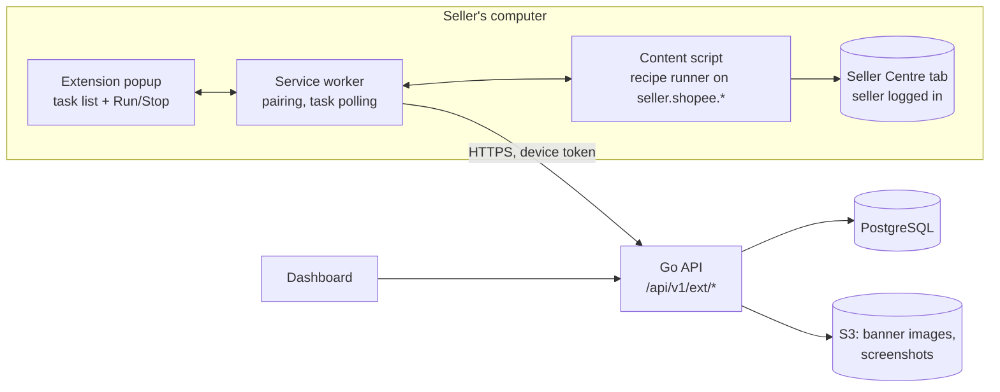

# Browser Extension — Shopee Shop Automation

Status: Phase 0 draft · Last updated: 2026-10-30 · Decision: Q-1 answered (see §1)

## 1. Decision

The product owner chose to automate operations that have **no Shopee Open API** (shop banner, shop decoration, warehouse setup, new addresses) with a **browser extension that runs in the seller's own browser**, instead of manual checklists.

This replaces the server-side Playwright browser worker for v1. Playwright stays in the stack for testing the extension (§9). A server-side worker can be reconsidered later if a use case needs unattended runs.

Why an extension and not a server-side Playwright worker:

| Concern | Server-side Playwright | Extension in the seller's browser |
|---|---|---|
| Login, OTP, CAPTCHA, device verification | Must be relayed to the user remotely; looks like a new device every time | The seller is already logged in on their own device; Shopee sees normal use |
| Credentials and cookies | Platform must store session cookies for every shop (high-value target) | Nothing leaves the browser; the platform stores no Shopee session |
| Detection as a bot | Datacenter IPs, headless fingerprints | Real browser, real IP, seller present |
| Tenant isolation | Must be engineered per context | Naturally isolated: one seller, one browser |
| Unattended runs | Yes | No: the seller's browser must be open, and the seller confirms each batch |
| Maintenance when Shopee changes UI | Same | Same; mitigated by remotely updated recipes (§5) |

## 2. Compliance guardrails

Shopee has not been asked to confirm this use. These rules keep the extension on the side of "a tool the seller uses on their own account" and away from the prohibited behaviors listed in the Platform Partner Rules (crawling, abuse of internal APIs, circumventing controls):

1. **UI actions only.** The extension clicks, types and uploads through the Seller Centre web page, like the seller would. It **never** calls Seller Centre's internal HTTP endpoints directly.
2. **Write-only, no data collection.** It reads only what it needs to (a) confirm which shop is logged in and (b) verify that its own change took effect. It does not read orders, buyers, chats, reports or any list pages.
3. **Seller present and in control.** Every batch needs a click on "Run" in the extension popup, showing exactly what will change. The seller can stop at any time.
4. **Never bypass security.** On a CAPTCHA, OTP, login page, verification or any unexpected page, it stops and asks the seller to finish it, then waits.
5. **Human pace.** Randomized 0.5–2 s delays between actions; one task at a time; no parallel tabs.
6. **Kill switch.** Each recipe and each capability can be disabled from the platform admin instantly. The extension checks before every task.
7. **API first.** If Shopee later adds an API for a capability, the registry switches it to `API` and the recipe is retired.

Residual risk: Shopee could still consider this a policy violation. The impact is limited to the BROWSER capabilities (we disable them), because the extension never uses the partner app's credentials. This risk stays in the register as R4.

## 3. Components



- **Manifest V3** extension for Chromium browsers (Chrome, Edge, Cốc Cốc, Brave). Firefox later.
- Built with **WXT** (Vite-based MV3 framework) + TypeScript strict + Vue 3 for the popup (same design system as the dashboard).
- Host permissions limited to the Seller Centre domains of the launch markets (e.g. `https://banhang.shopee.vn/*`, `https://seller.shopee.sg/*`) and our API origin. Exact domains are confirmed per market in Phase 6.
- Permissions: `storage`, `alarms`, `activeTab`, `scripting`. No `cookies`, no `webRequest`, no `<all_urls>`.

## 4. Pairing and authentication

1. In the dashboard, the user opens **Settings → Browser extension → Connect**. The API creates a one-time pairing code (6 min TTL), bound to user + org.
2. The extension opens `https://app.<domain>/ext/pair?code=...`; the page (same origin as the API, user's session) confirms and the API issues a **device token**: random 256-bit, stored hashed in `extension_devices`, scoped to `(user_id, org_id)`, 30-day sliding expiry, revocable from the dashboard.
3. The extension sends `Authorization: Bearer <device token>` to `/api/v1/ext/*`. These routes do not use cookies, so CSRF does not apply. CORS allows only the extension origin (`chrome-extension://<id>`).
4. All task authorization is re-checked on the server: the device's user must still be a member with `workflows.run`, and the task's org must equal the device's org.

## 5. Recipes

A **recipe** describes how to perform one capability in Seller Centre, as **declarative data**, not code (MV3 forbids remotely hosted code; data is allowed).

```json
{
  "key": "shop.banner.upload",
  "version": 3,
  "market": "VN",
  "start_url": "https://banhang.shopee.vn/portal/decoration",
  "preconditions": [{ "assert_shop_id": "{{task.shopee_shop_id}}" }],
  "steps": [
    { "wait_for": { "role": "button", "name_any": ["Chỉnh sửa", "Edit"] }, "timeout_ms": 15000 },
    { "click":    { "role": "button", "name_any": ["Chỉnh sửa", "Edit"] } },
    { "upload":   { "selector": "input[type=file][accept*=image]", "file": "{{input.banner_image}}" } },
    { "click":    { "role": "button", "name_any": ["Lưu", "Save"] } },
    { "expect":   { "text_any": ["Đã lưu", "Saved"] }, "timeout_ms": 20000 }
  ],
  "verify": [{ "image_present": { "selector": "[data-banner] img" } }],
  "stop_on": [{ "url_matches": "/login|/verify|/captcha" }, { "text_any": ["Xác minh", "Verify"] }]
}
```

(Selectors above are illustrative, not real. Real recipes are written and tested against Seller Centre in Phase 6.)

- The runner supports a fixed set of actions: `goto`, `wait_for`, `click`, `fill`, `select`, `upload`, `expect`, `assert_shop_id`, `screenshot`. Anything else is rejected.
- Selectors prefer accessible role + name, then stable attributes, then CSS as last resort.
- Recipes are versioned and stored in the backend (`browser_recipes`), served signed (Ed25519) so a compromised network path cannot inject steps. The extension verifies the signature with a public key bundled in the build.
- A failed `expect` or a `stop_on` match ends the task as `FAILED` or `WAITING_USER`, with a screenshot.

**Shop identity check (critical):** before any write, `assert_shop_id` confirms that the logged-in Seller Centre shop is the task's `shopee_shop_id`. If it is a different shop, the task stops. This prevents applying org A's template to a shop the browser happens to be logged into.

## 6. Task flow

```mermaid
sequenceDiagram
  autonumber
  participant WF as Workflow engine
  participant API
  participant EXT as Extension
  actor S as Seller
  participant SC as Seller Centre tab
  WF->>API: step with mode BROWSER → create browser_task (QUEUED)
  WF->>WF: step → WAITING_USER ("Run in browser extension")
  API-->>S: notification + dashboard banner
  S->>EXT: open popup (or extension polls every 60 s while a Seller Centre tab is open)
  EXT->>API: GET /ext/tasks?status=QUEUED
  EXT-->>S: list: shop, action, preview (e.g. banner image)
  S->>EXT: Run
  EXT->>API: POST /ext/tasks/{id}/claim → lease 10 min + signed recipe + presigned input files
  EXT->>SC: content script runs recipe (assert shop → actions → verify)
  alt verification page / CAPTCHA / OTP
    EXT-->>S: "Please finish verification in the tab, then click Continue"
    S->>SC: completes it
    S->>EXT: Continue
  end
  EXT->>API: POST /ext/tasks/{id}/result {status, per-step log, screenshot keys}
  API->>WF: step → SUCCEEDED / FAILED; workflow resumes
```

- Tasks are grouped by shop. The popup shows "Log in to shop X to run 3 tasks" when the open Seller Centre session belongs to another shop.
- Lease and fencing follow the workflow engine (lease token on result). An abandoned claim returns to `QUEUED` after the lease expires.
- If no extension picks the task up, the step stays `WAITING_USER`. The user can also click "I did it manually", which falls back to the manual checklist.

## 7. Data and security

| Item | Rule |
|---|---|
| Shopee cookies / passwords | Never read, never sent. The extension has no `cookies` permission. |
| Device token | `chrome.storage.local`; revocable; rotated on every refresh; hashed in DB |
| Input files (banner images) | Fetched from short-lived presigned S3 URLs, kept in memory only |
| Screenshots | Taken only on failure or final verification, of the active tab; masked areas defined in the recipe; uploaded to an encrypted bucket; 14-day lifecycle; access audited |
| Logs sent back | Step name, outcome, duration, error text. No page HTML. |
| Updates | Extension updates through the store; recipes update from the backend without a store release |
| Supply chain | Locked dependencies, `npm audit` + provenance in CI, minimal permissions reviewed in each release |

## 8. Changes to other documents

- **Capability registry:** mode `BROWSER` now means "run by the browser extension". `shop.banner.upload`, `shop.decoration.update`, `shop.warehouse.update` and `shop.address.create` are `BROWSER` with fallback `MANUAL`, `enabled = false` until their recipe passes Phase 6 verification.
- **Database:** new tables `extension_devices`, `extension_pairing_codes`, `browser_recipes`; `browser_tasks` gains `device_id`, `recipe_key`, `recipe_version`, `lease_token`.
- **API:** `/api/v1/ext/*` replaces the internal browser-worker endpoints.
- **Spec deviation:** master spec §10 asks for a separate Node.js 26 Playwright worker app. v1 delivers the extension instead, for the reasons in §1. Node 26 + Playwright are used for the extension's build and tests.

## 9. Testing

- Unit: recipe schema validation, template rendering, signature verification, step runner against a fake DOM (happy-dom).
- Integration: Playwright launches Chromium with the unpacked extension against **local fixture pages** that mimic Seller Centre flows (no real Shopee accounts in CI). Tests cover shop-ID mismatch, CAPTCHA stop, lease expiry and retry.
- Recipe smoke tests: run manually per market against a sandbox/test seller account before enabling a recipe; the result sets `last_verified_at`.
- Monitoring: recipe failure rate per version; automatic disable when the failure rate exceeds a threshold (e.g. Shopee changed the page).

## 10. Open items

| ID | Item |
|---|---|
| E-1 | Exact Seller Centre domains and page URLs per launch market |
| E-2 | How to read the logged-in shop ID safely from the page (visible UI element vs page metadata), without calling internal APIs |
| E-3 | Whether Seller Centre allows several shops in one browser session (main/sub accounts) or the seller must switch accounts |
| E-4 | Chrome Web Store listing type (public vs unlisted) and the privacy disclosure text |
