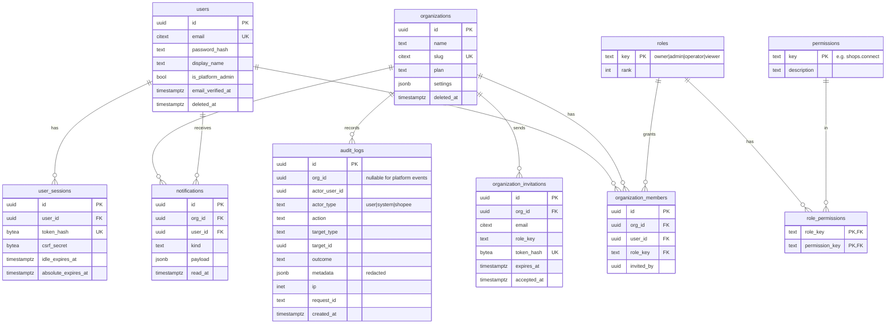
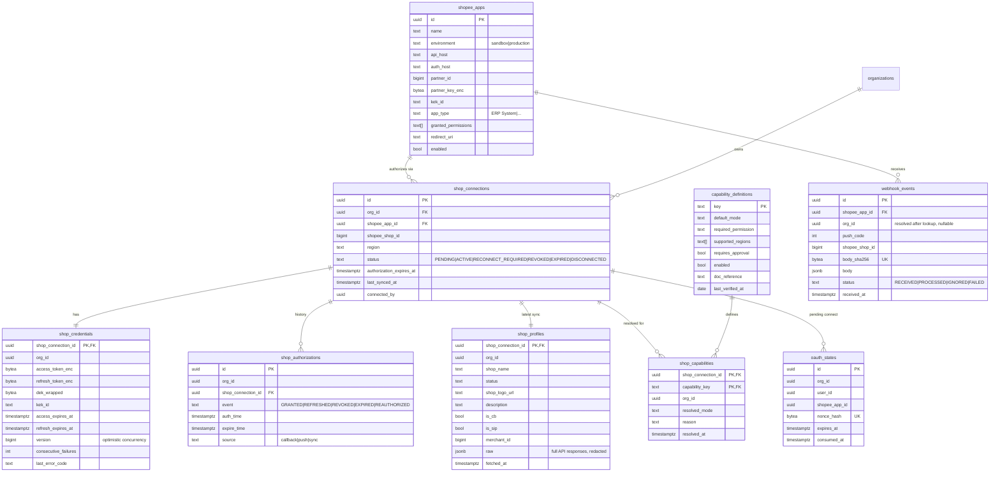
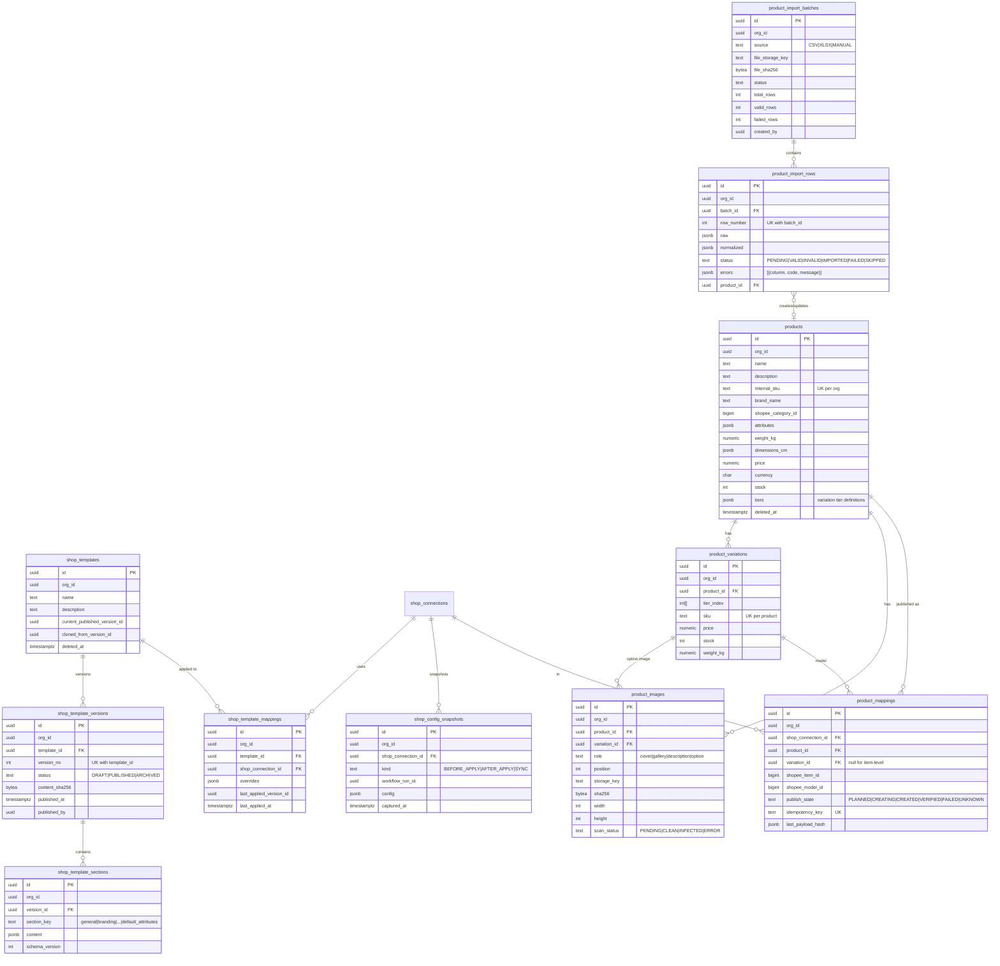
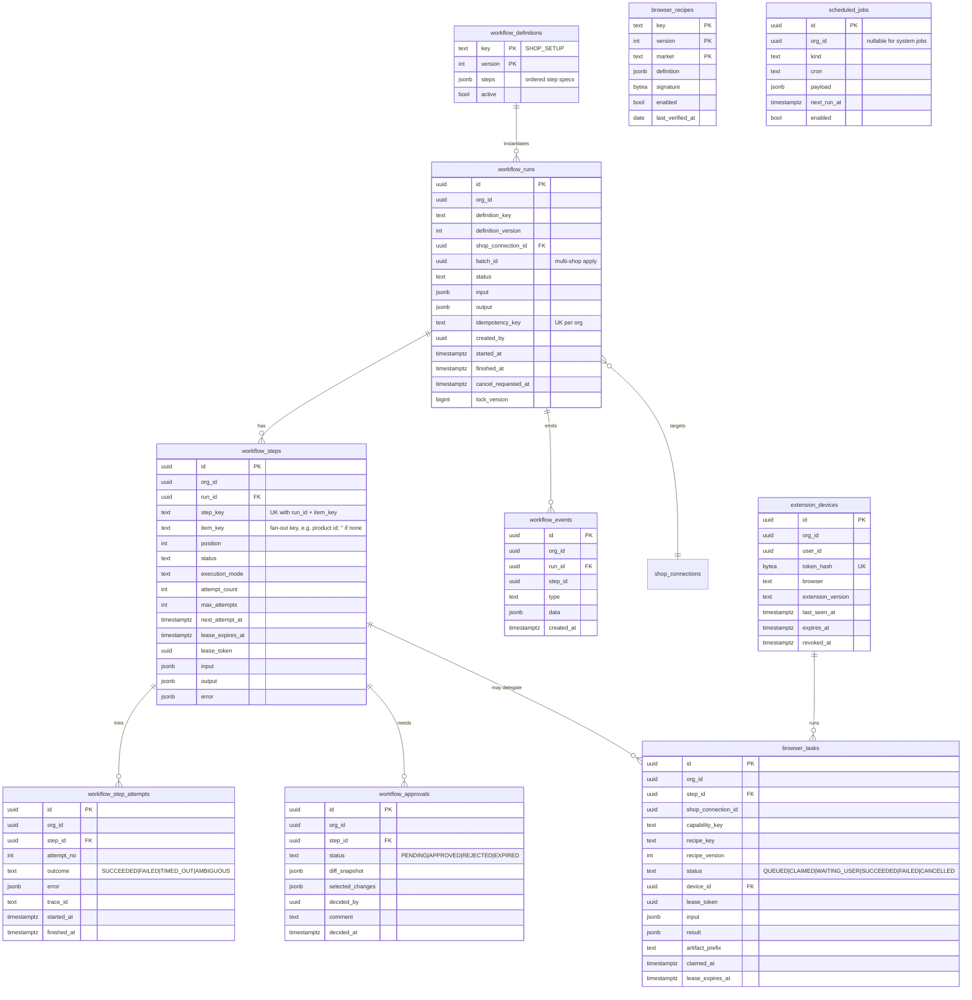

# Database Design — Shopee Shop Automation

Status: Phases 1–2 implemented · Last updated: 2026-10-30 · Engine: PostgreSQL 17

## 1. Conventions

- Primary keys: `id uuid` (UUIDv7, generated in Go).
- Every tenant-owned table has `org_id uuid NOT NULL` and a unique `(org_id, id)` so children can reference it with a **composite foreign key**.
- Timestamps: `timestamptz`, stored in UTC; `created_at`, `updated_at` default `now()`.
- Status columns are `text` + `CHECK` constraints (easier to evolve than Postgres enums).
- JSONB for flexible configuration (template sections, snapshots, step input/output). Every JSONB column has a Go struct and a `schema_version` field inside.
- Soft delete (`deleted_at`) only for `organizations`, `users`, `shop_templates` and `products`, where users expect undo or where history references them. Everything else is hard-deleted or immutable.
- Money: `numeric(14,2)` + `currency char(3)`.
- Secrets: `bytea` ciphertext columns ending in `_enc`, plus `kek_id`.

## 2. ERD

Split into four diagrams for readability. `org_id` is omitted from relationship lines but present on every tenant table.

### 2.1 Identity, tenancy, audit



Platform roles: Platform Admin is `users.is_platform_admin`, not an org role, so it never implicitly grants tenant access. Platform-admin endpoints live under `/api/v1/admin/*` and use `app_system` only where cross-tenant reads are needed, always audited.

### 2.2 Shopee integration



`capability_definitions` is global (not tenant data, no RLS). Its overrides per region/app live in `capability_overrides (capability_key, shopee_app_id NULL, region NULL, mode, enabled)`.

### 2.3 Templates and products



Shopee image IDs from `media_space.upload_image` are stored per shop in `product_image_uploads (org_id, product_image_id, shop_connection_id, shopee_image_id, shopee_image_url, uploaded_at)`. Whether an `image_id` can be reused across shops of the same seller is unverified, so we upload per shop.

### 2.4 Workflow and system



### 2.5 As built (Phase 6)

Migration `00006_extension.sql`:

| Table | Notes |
|---|---|
| `extension_pairing_codes` | SHA-256 of the code, 6-minute expiry, `used_at`; FK to the membership |
| `extension_devices` | SHA-256 of the token, sliding `expires_at`, `revoked_at`; FK to the membership (removing the member removes the device) |
| `browser_recipes` | Platform-wide (no `org_id`, no RLS); `UNIQUE (capability_key, market, version)`; at most one enabled per capability and market; `CHECK (NOT enabled OR verified_at IS NOT NULL)`; success/failure counters |
| `browser_tasks` | `UNIQUE (step_id, task_key)`; composite FKs to shop, run, step, device; lease token present exactly when `RUNNING`/`WAITING_USER`; input (text values, storage keys of files), preview, step log |
| `browser_task_screenshots` | Storage keys of screenshots, at most 10 per task (enforced in code) |

The app_system role may read only `(id, org_id, code_hash, expires_at, used_at)` of pairing codes and `(id, org_id, token_hash)` of devices.

## 3. Key constraints and indexes

| Table | Constraint / index | Purpose |
|---|---|---|
| organization_members | `UNIQUE (org_id, user_id)` | One role per user per org |
| organization_members | partial unique: one `owner` per org | Ownership invariant |
| shop_connections | `UNIQUE (shopee_app_id, shopee_shop_id) WHERE status <> 'DISCONNECTED'` | A shop belongs to one org at a time |
| shop_credentials | index `(access_expires_at)` | Refresh scheduler |
| shop_connections | index `(authorization_expires_at)` | Expiry warnings |
| shop_template_versions | `UNIQUE (template_id, version_no)`; trigger rejects UPDATE when `status = 'PUBLISHED'` except `→ ARCHIVED` | Immutability enforced in DB |
| shop_template_sections | trigger rejects INSERT/UPDATE/DELETE if parent version is published | Immutability |
| products | `UNIQUE (org_id, sku) WHERE deleted_at IS NULL` (`sku` is `citext`) | Dedup on import; `item_sku` sent to Shopee |
| product_variations | `UNIQUE (product_id, tier_index)`; `UNIQUE (product_id, sku) WHERE sku IS NOT NULL` | One model per option combination |
| product_mappings | `UNIQUE (shop_connection_id, product_id)`; `UNIQUE (idempotency_key)` | One listing per product per shop (as built: models are kept as JSON on the mapping, not one row per variation) |
| product_image_uploads | `UNIQUE (product_image_id, shop_connection_id)` | Upload each image once per shop |
| product_import_rows | `UNIQUE (batch_id, row_number)` | Row identity for retries |
| workflow_runs | `UNIQUE (org_id, idempotency_key)` | Double-submit protection |
| workflow_runs | partial unique `(shop_connection_id) WHERE status IN ('PENDING','RUNNING','WAITING_APPROVAL','WAITING_USER') AND definition_key = 'SHOP_SETUP'` | One mutating setup per shop |
| workflow_steps | `UNIQUE (run_id, step_key, item_key)` | Idempotent step creation |
| workflow_steps | index `(status, next_attempt_at)` where runnable | Sweeper |
| webhook_events | `UNIQUE (shopee_app_id, body_sha256)` | Dedupe Shopee retries |
| audit_logs | BRIN on `created_at`; btree `(org_id, created_at DESC)` | Large append-only table |

Partitioning: `audit_logs` and `workflow_events` are range-partitioned by month from day one (cheap to add now, painful later). Old partitions are detached and archived per the retention policy.

## 4. Tenant isolation

Phase 1 tables with RLS: `organizations`, `organization_members`, `organization_invitations`, `audit_logs`. Global tables without RLS: `users`, `user_sessions`, `user_tokens`, `roles`, `permissions`, `role_permissions`.

Two policies differ from the template below:
- `organizations` and `organization_members` are also readable for the current user's own memberships (`app.user_id`), so "my organizations" can be listed before a tenant is chosen.
- `audit_logs` accepts rows with `org_id IS NULL` only when no tenant is set (user-level events such as logins), and is append-only: the app role has no `UPDATE`/`DELETE` grant and a trigger rejects both for every role.

Invitation tokens embed the organization ID (`<org-hex>.<random>`) so the tenant scope can be set before the token lookup, without a cross-tenant query.

Phase 2 tables with RLS: `shop_connections`, `shop_credentials`, `shop_authorizations`, `shop_profiles`, `oauth_states`. Global tables without RLS: `shopee_apps` (platform admins manage them; partner keys are encrypted), `capability_definitions`, `capability_overrides` (seeded registry) and `webhook_events` (an inbox written before the owning org is known; it holds push bodies, never tokens).

Phase 2 notes:
- A shop belongs to one organization while connected: partial unique index `(shopee_app_id, shopee_shop_id) WHERE status NOT IN ('DISCONNECTED', 'REVOKED')`. Unique indexes are not filtered by RLS, so this holds across tenants without a cross-tenant query. Reconnecting in the same org reuses the row via `UNIQUE (org_id, shopee_app_id, shopee_shop_id)`.
- `shop_capabilities` from the ERD is not stored: capabilities are computed on read by a pure resolver from the registry, the overrides, the app and the connection.
- `oauth_states` uses the same `<org-hex>.<random>` token format as invitations. For main-account logins it also keeps the token pair (encrypted, own data key) and the offered shop IDs for 30 minutes, until the user picks shops; the ciphertext is cleared after selection.
- Disconnect deletes `shop_credentials` and `shop_profiles` (Shopee content) at once and keeps the connection row and `shop_authorizations` as history.

Phase 3 tables with RLS: `shop_templates`, `shop_template_versions`, `shop_template_sections`, `shop_template_mappings`.

Phase 3 notes:
- One open draft per template: partial unique index `(template_id) WHERE status = 'DRAFT'`. Version numbers are per template (`UNIQUE (template_id, version_no)`).
- A check ties `content_sha256` and `published_at` to non-draft status. The hash is SHA-256 of the canonical JSON of all sections (sorted keys).
- Published and archived sections are immutable in the database: a trigger rejects `INSERT`/`UPDATE`/`DELETE` on sections whose version is not `DRAFT`, whatever the application does. A test checks it.
- `shop_template_sections.content` is validated against the section's JSON Schema on every write (in the application); the column only enforces "is an object".
- `shop_config_snapshots` arrived in Phase 4 (`BEFORE_APPLY` and `AFTER_APPLY` per run). Previews still compare against `shop_profiles`; runs compare against what they read.
- Template names are unique per org among non-deleted templates (`lower(name)`).

Phase 4 tables with RLS: `workflow_runs`, `workflow_steps`, `workflow_step_attempts`, `workflow_approvals`, `workflow_events` (append-only, monthly partitions), `shop_config_snapshots`.

Phase 4 notes:
- Idempotency: `(org_id, idempotency_key)` is indexed, not unique, because one apply request creates one run per shop. The apply transaction takes an advisory lock on the key and compares a request hash, so a repeated key returns the same runs and a different request with the same key is `409`.
- One active SHOP_SETUP per shop: partial unique index on `shop_connection_id` for active statuses.
- `workflow_steps` has a check tying `status = RUNNING` to a lease token. `workflow_approvals` allows one pending approval per step.
- `app_system` gets read-only column grants on `workflow_steps` and `workflow_runs` for the sweeper, never input, output or diffs (tested).
- Migration `00004` switches `shop.avatar.upload` to `MANUAL` until S-4 is verified.

### 4.1 Roles

| DB role | Used by | Privileges |
|---|---|---|
| `app_owner` | `cmd/migrate` | Owns schema. Never used at run time. |
| `app_rw` | api, worker | DML on tables; **no** `BYPASSRLS`; not owner, so `FORCE RLS` applies |
| `app_system` | worker: webhook routing, due-refresh scan | `BYPASSRLS`; column-level `SELECT` only (`shop_connections`: ids, org, status; `shop_credentials`: ids, org, expiries, failure count; `shopee_apps`: id, enabled). No access to ciphertext or names, no writes. Later phases add grants as needed. |
| `app_readonly` | analytics, support (later) | `SELECT` with RLS |

### 4.2 Policy template

Applied by migration to every tenant table:

```sql
ALTER TABLE products ENABLE ROW LEVEL SECURITY;
ALTER TABLE products FORCE ROW LEVEL SECURITY;

CREATE POLICY tenant_isolation ON products
  USING      (org_id = current_setting('app.org_id', true)::uuid)
  WITH CHECK (org_id = current_setting('app.org_id', true)::uuid);
```

`current_setting(..., true)` returns `NULL` when unset, so queries without a tenant see nothing and inserts fail. Tables reachable before a tenant is known (`users`, `user_sessions`, `organizations` lookup by membership) use explicit policies keyed on `app.user_id` instead.

### 4.3 Composite foreign keys

```sql
ALTER TABLE products ADD CONSTRAINT products_org_id_id_uk UNIQUE (org_id, id);

ALTER TABLE product_variations
  ADD CONSTRAINT product_variations_product_fk
  FOREIGN KEY (org_id, product_id) REFERENCES products (org_id, id) ON DELETE CASCADE;
```

### 4.4 Transaction helper

```go
// InTenantTx runs fn in a transaction scoped to orgID. RLS sees only that org's rows.
func (d *DB) InTenantTx(ctx context.Context, orgID uuid.UUID, fn func(q *sqlc.Queries) error) error
```

It runs `SELECT set_config('app.org_id', $1, true)` as the first statement. A CI test asserts that every sqlc query against a tenant table returns zero rows when run outside `InTenantTx`.

## 5. Transactions and concurrency

- Related state changes plus their audit row and workflow event commit together.
- Outbox: enqueuing an Asynq task happens **after** commit. If the enqueue fails, the sweeper picks up the runnable step later, so no task is lost.
- Token refresh: `SELECT ... FROM shop_credentials WHERE shop_connection_id = $1 FOR UPDATE` serializes refreshers per shop (see [shopee-integration.md §4](shopee-integration.md#4-token-lifecycle)).
- Step claiming: `UPDATE workflow_steps SET status='RUNNING', lease_token=$new, lease_expires_at=now()+timeout WHERE id=$1 AND (status = 'PENDING' OR (status = 'RUNNING' AND lease_expires_at < now())) AND (next_attempt_at IS NULL OR next_attempt_at <= now()) RETURNING ...`. Zero rows → the step is already taken or done; the task is dropped.

## 6. Migrations

- `goose` SQL migrations in `db/migrations/`, numbered `YYYYMMDDHHMM_name.sql`, each with `-- +goose Up` / `-- +goose Down`.
- Expand/contract for breaking changes: add column → backfill → switch code → drop later.
- CI runs `up`, `down` to zero, `up` again on a fresh Postgres 17 container.

## 7. Backup and recovery

- Continuous WAL archiving to object storage + daily base backups (pgBackRest or the managed provider's PITR). RPO ≤ 15 min.
- Backups are encrypted; KEKs are **not** in the same backup set, so a stolen backup does not expose Shopee tokens.
- Quarterly restore drill into a scratch environment, verified by running the cross-tenant test suite against it.
