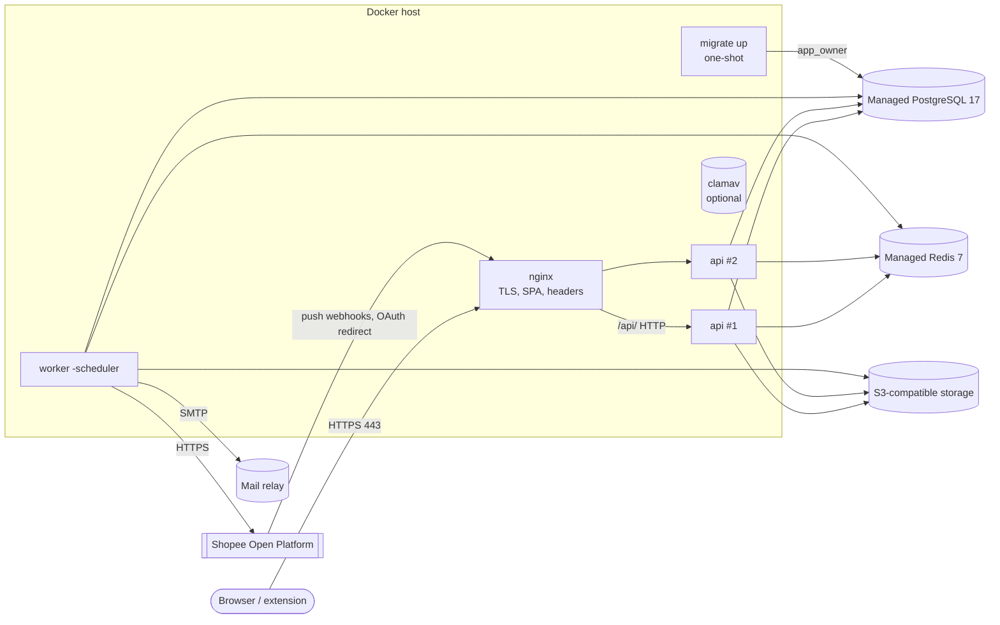

# Deployment

This document describes how to run the system in production, configure it, upgrade it, back it up and manage its keys. Operational procedures for incidents are in [runbooks.md](runbooks.md).

> **Status.** The managed platform (container service, managed PostgreSQL, Redis and object storage) has **not been chosen yet**. `deploy/production/` is a **single-host reference** using Docker Compose. It fixes the shape any target must keep: migrations first, a stateless API behind a TLS proxy, exactly one scheduler, secrets from files, external stateful services. Moving to a managed container platform keeps the same image, environment variables and ordering.

## 1. Production architecture



| Service | Image / entrypoint | Count | Notes |
|---|---|---|---|
| `migrate` | `/usr/local/bin/migrate up` | one-shot | Runs as `app_owner`. `api` and `worker` start only after it exits 0. |
| `api` | `/usr/local/bin/api` | 2 (stateless, scale freely) | No published port; only nginx reaches it. `TRUST_PROXY_HEADERS=true`. |
| `worker` | `/usr/local/bin/worker -scheduler` | **exactly 1** with `-scheduler` | Extra workers (more throughput) run **without** `-scheduler`. |
| `nginx` | `nginxinc/nginx-unprivileged` | 1 per host | TLS, HSTS, CSP, gzip, body limits, serves the SPA, proxies `/api/`. |
| `clamav` | `clamav/clamav` (profile `clamav`) | 0 or 1 | clamd on TCP 3310; needs about 3 GB RAM. Enabled by `CLAMAV_ADDR`. |

All Go processes come from one distroless image built by `deploy/Dockerfile` (`api` is the default entrypoint; `worker`, `migrate` and `admin` are in `/usr/local/bin`).

Container hardening in the reference: read-only root filesystem (tmpfs `/tmp`), `no-new-privileges`, all capabilities dropped, non-root user (65532 for Go, 101 for nginx), CPU/memory limits, `restart: unless-stopped`, json-file logs rotated at 20 MB × 5.

Health endpoints: `GET /healthz` returns 204 when the process is up; `GET /readyz` returns 204 when Postgres (app_rw pool) and Redis answer within 2 s, otherwise 503. Nginx returns 404 for both on the public host. Its container healthcheck probes the API's `/readyz` through the internal upstream. The `api` container checks itself with `api -healthcheck` (the binary requests its own `/readyz`; the distroless image has no curl). The worker has no HTTP endpoint at all; watch its logs (`worker started`, `task failed`).

### 1.1 Request limits at the edge

| Path | `client_max_body_size` | API limit |
|---|---|---|
| `POST /api/v1/orgs/{org}/imports` | 21 MB | import file 20 MB + multipart overhead |
| `POST /api/v1/orgs/{org}/products/{id}/images` | 11 MB | image 10 MB |
| Everything else | 2 MB | JSON bodies 1 MiB, webhooks 64 KiB |

Nginx also applies a coarse per-IP limit of 30 requests/s (burst 60) on `/api/`. The API has finer limits for login, registration, verification and extension pairing, stored in Redis.

### 1.2 Client IPs and proxies

The API uses the **left-most** `X-Forwarded-For` entry as the client IP when `TRUST_PROXY_HEADERS=true`. Nginx **overwrites** the header with `$remote_addr`. Keep both of these rules:

- The API must never be reachable except through nginx. The reference publishes no API port.
- If a cloud load balancer sits in front of nginx, configure `set_real_ip_from <LB ranges>` and `real_ip_header X-Forwarded-For` in nginx, so that `$remote_addr` is the real client. Never pass a client-supplied header through unchanged.

## 2. Configuration and secrets

Configuration is read from environment variables (`internal/platform/config/config.go`). Every variable read by the shared loader can instead be supplied as a file path in `<NAME>_FILE`; the file content is trimmed. **In production every secret is passed as a `_FILE` pointing at a Docker secret** (`/run/secrets/<name>`). Secrets never go in `production.env`, in the image, or on a command line.

### 2.1 Variable matrix

Processes: **A** = api, **W** = worker, **M** = migrate, **ad** = admin CLI.

| Variable | Required | Processes | Secret | Production value / example |
|---|---|---|---|---|
| `APP_ENV` | yes | A W M | no | `production` (enables the production rules below) |
| `HTTP_ADDR` | no | A | no | `:8080` |
| `PUBLIC_BASE_URL` | yes | A W | no | `https://app.example.com`. Must be https in production. Used for email links and the Origin check. |
| `DATABASE_URL` | yes | A W ad | **yes** | `postgres://app_rw:…@db:5432/shopee_automation?sslmode=verify-full` (runtime role, RLS enforced) |
| `DATABASE_SYSTEM_URL` | W: yes, A: recommended | A W | **yes** | `postgres://app_system:…@…` (BYPASSRLS, narrow column grants). The worker refuses to start without it. |
| `DATABASE_MIGRATE_URL` | yes | M | **yes** | `postgres://app_owner:…@…` (schema owner) |
| `REDIS_URL` | yes | A W | **yes** | `rediss://:…@redis:6380/0` (TLS) |
| `ENCRYPTION_KEYS` | yes | A W (ad rewrap) | **yes** | `prod2:<base64>,prod1:<base64>`: KEK ring, 32-byte keys from `admin gen-key` |
| `ENCRYPTION_ACTIVE_KEY` | yes if more than one key | A W | no | `prod2`: the KEK used for new data |
| `S3_ENDPOINT` | yes | A W | no | `s3.eu-west-1.amazonaws.com` (host[:port], no scheme) |
| `S3_ACCESS_KEY` | yes | A W | **yes** | from the storage provider |
| `S3_SECRET_KEY` | yes | A W | **yes** | from the storage provider |
| `S3_BUCKET` | no | A W | no | `shopee-automation-prod` (default `shopee-automation`) |
| `S3_REGION` | no | A W | no | default `us-east-1` |
| `S3_USE_SSL` | no | A W | no | must be `true` in production (default true) |
| `COOKIE_SECURE` | no | A | no | must be `true` in production (default true) |
| `SESSION_IDLE_TTL` / `SESSION_ABSOLUTE_TTL` | no | A | no | `12h` / `168h`; idle must not exceed absolute |
| `TRUST_PROXY_HEADERS` | no | A | no | `true` **only** behind nginx (see 1.2) |
| `SMTP_ADDR` | yes in practice | W (A) | no | `relay:25`. Empty means emails are only logged. |
| `SMTP_FROM` | no | W (A) | no | `no-reply@example.com` |
| `SMTP_USERNAME` | no | W (A) | no | Relay login; with it the password is sent with PLAIN over STARTTLS (net/smtp refuses plain auth without TLS except to localhost) |
| `SMTP_PASSWORD_FILE` | with `SMTP_USERNAME` | W (A) | **yes** | `/run/secrets/smtp_password` (an empty file when the relay needs no login) |
| `OTEL_EXPORTER_OTLP_ENDPOINT` | no | A W | no | `http://otel-collector:4318`. Empty disables tracing. |
| `LOG_LEVEL` | no | A W | no | `info` |
| `SHOPEE_HTTP_TIMEOUT` | no | A W | no | `15s` |
| `SHOPEE_RATE_PER_APP` / `SHOPEE_RATE_PER_SHOP` | no | A W | no | `50` / `5` requests per second |
| `RECIPE_SIGNING_KEY` | yes if the extension is used | A W | **yes** | base64 Ed25519 seed from `admin gen-recipe-key`. Empty means the extension cannot claim tasks. |
| `RECIPE_SIGNING_KEY_ID` | no | A W | no | `k1`. Must exist in the extension's `WXT_RECIPE_PUBLIC_KEYS`. |
| `EXTENSION_ORIGINS` | yes if the extension is used | A | no | `chrome-extension://<id>`. Only `chrome-extension://` origins are accepted in production. |
| `CLAMAV_ADDR` | no | A W | no | `clamav:3310`. Empty disables malware scanning. |
| `REQUIRE_ADMIN_MFA` | no | A | no | Default `true` in production, and must stay `true` there: platform admin routes require two-step verification. |
| `PWNED_PASSWORDS_URL` | no | A | no | `https://api.pwnedpasswords.com/range/`: breached-password check (k-anonymity). Empty disables it. |
| `WORKFLOW_ORG_CONCURRENCY` | no | W | no | `10`: running workflow steps per organization (1–1000) |
| `ORG_RETENTION` | no | W ad | no | `720h`: how long a deleted organization is kept before purge (≥ 24h) |

Extension build variables (`extension/build/env.ts`) are set as GitHub repository **variables** (they are public values bundled into the extension): `WXT_API_ORIGIN` (https origin of the dashboard/API), `WXT_SELLER_ORIGINS`, `WXT_FILE_ORIGINS` (the S3 presigned-URL origin), and `WXT_RECIPE_PUBLIC_KEYS` (JSON `{"k1":"<base64 public key>"}`).

### 2.2 Files in `deploy/production/`

| File | Committed | Purpose |
|---|---|---|
| `docker-compose.yml` | yes | Service definitions |
| `production.env.example` | yes | Non-secret settings with placeholders. Copy it to `production.env` (git-ignored). |
| `secrets.example/<name>` | yes | Placeholder secret files (`REPLACE_ME`). Real ones go in `secrets/<name>` (git-ignored). |
| `nginx/` | yes | nginx main config, site config, header and proxy snippets |
| `check.sh` | yes | `make prod-config-check`: `compose config` and `nginx -t` with placeholders and a throwaway certificate |

Secret files: one value per file, owner `root`, group `65532`, mode `0640` (`chgrp 65532 secrets/*; chmod 0640 secrets/*`). Compose bind-mounts them read-only at `/run/secrets/<name>`. On a managed platform use its secret manager and mount the values as files, keeping the same `_FILE` variables.

## 3. Database roles

Create these once per cluster (the platform team or a DBA does this, not the application):

```sql
CREATE ROLE app_owner  LOGIN PASSWORD '…' NOSUPERUSER;          -- owns the schema, runs migrations
CREATE ROLE app_rw     LOGIN PASSWORD '…' NOSUPERUSER NOBYPASSRLS;
CREATE ROLE app_system LOGIN PASSWORD '…' NOSUPERUSER BYPASSRLS; -- narrow grants come from migrations
CREATE DATABASE shopee_automation OWNER app_owner;
-- Backups and restores (section 7) need a role that can read every row:
CREATE ROLE app_backup LOGIN PASSWORD '…' BYPASSRLS IN ROLE pg_read_all_data;
```

Creating a `BYPASSRLS` role needs superuser rights in vanilla PostgreSQL. Managed providers differ: some allow it from their admin role, others don't. If yours does not, run logical backups with the provider's own export tool and rely on its PITR.

Use `sslmode=verify-full` with the provider's CA in every URL. Development does the same in `deploy/postgres/init/01-roles.sh`, where `app_owner` is the container superuser.

## 4. First deploy

1. Provision PostgreSQL 17 (with PITR, see 7.2), Redis 7 (TLS, password, `maxmemory-policy noeviction`), an S3 bucket (private, versioning on), an SMTP relay, and a DNS name.
2. Create the roles and database (section 3).
3. Generate keys on a trusted machine:
   - `docker run --rm --entrypoint /usr/local/bin/admin <image> gen-key` → `prod1:<key>` in `secrets/encryption_keys`; set `ENCRYPTION_ACTIVE_KEY=prod1`.
   - `… admin gen-recipe-key` → the seed goes in `secrets/recipe_signing_key`. Put the public key in the repository variable `WXT_RECIPE_PUBLIC_KEYS` as `{"k1":"<public key>"}`.
   - Store both in the password manager/secret manager as well. **Losing the KEK makes every Shopee token and partner key unreadable.**
4. On the host: copy `production.env.example` to `production.env` and fill it in. Create `secrets/` from `secrets.example/` with real values. Replace `app.example.com` in `nginx/conf.d/app.conf`. Put `fullchain.pem`/`privkey.pem` in `TLS_DIR`. Unpack `web-dist-<tag>.tar.gz` from the release into `WEB_DIST_DIR`.
5. `make prod-config-check` (in a checkout), then on the host:
   `docker compose -f deploy/production/docker-compose.yml --env-file deploy/production/production.env up -d`
6. Check: `docker compose … ps` (migrate exited 0, nginx healthy), `curl -sI https://app.example.com/` (headers present), sign up, then create the first platform admin:
   `docker compose … run --rm --no-deps --entrypoint /usr/local/bin/admin api promote -email you@example.com`
7. In the admin UI, register the Shopee app (partner id/key). Set the push callback URL to `https://<host>/api/v1/webhooks/shopee/<appID>` and the redirect URL to `https://<host>/api/v1/oauth/shopee/callback`.
8. Publish the extension built by the release workflow. Then set `EXTENSION_ORIGINS=chrome-extension://<store id>` and restart `api`.
9. Schedule backups (section 7) and run a restore drill.

## 5. Upgrades

Releases are tags `v*`. `.github/workflows/release.yml` builds the image (GHCR, SBOM and provenance), the web bundle, and the extension zip, and attaches them to a draft release. It also runs `govulncheck` and `npm audit`. There is no automatic deployment (the `deploy` job is a disabled placeholder).

Order for each upgrade:

1. Read the release notes for migrations that need care, such as long index builds or data backfills.
2. Take an on-demand backup or provider snapshot.
3. Set `IMAGE_TAG` to the new version and run **migrations first**:
   `docker compose … run --rm migrate`
4. Roll the API and worker: `docker compose … up -d --no-deps api worker`. Compose replaces containers one service at a time. On SIGTERM the API drains in-flight requests for up to 20 s, and the worker waits for running tasks.
5. Swap the web bundle: unpack into a new directory, point `WEB_DIST_DIR` at it (`current` symlink), then `docker compose … up -d --no-deps nginx`. The bundle and its `csp.conf` must come from the same build: the CSP holds the hash of that build's inline script.

**Zero-downtime rules.** Migrations must be backward compatible with the previous release (expand, then contract). Add columns as nullable or with defaults. Create large indexes `CONCURRENTLY`. Drop or rename only in a later release, after no running code uses the old shape. With that rule, old API replicas keep working while migrations run. Compose on one host cannot do a true rolling restart across replicas; on a container platform use rolling updates with `/readyz` as the readiness probe. Workflow steps survive worker restarts: an interrupted step's lease expires and the sweeper re-enqueues it.

**Rollback.** Redeploy the previous `IMAGE_TAG` for `api`/`worker` (allowed because migrations are backward compatible). `migrate down-all` is disabled in production; never roll the schema back. Fix forward instead.

## 6. Scaling

- **API:** stateless. Sessions, CSRF secrets and all state live in Postgres; rate-limit counters live in Redis. Add replicas freely (`deploy.replicas`). Nginx resolves `api` through Docker DNS every 10 s.
- **Worker:** asynq consumers. Add throughput with more worker containers or `-concurrency`, but **never more than one process with `-scheduler`**. A second scheduler duplicates periodic tasks. The tasks are idempotent, but this wastes Shopee quota. To scale, add a `worker-extra` service with the same settings and `command: ["-concurrency","10"]`.
- **Shopee rate limits** are global, enforced in Redis (`SHOPEE_RATE_PER_APP`, `SHOPEE_RATE_PER_SHOP`), so adding workers does not raise the call rate to Shopee.
- **Postgres connections:** each process opens two pools (app_rw and app_system). Keep the total below the provider's connection limit, or put a pooler (transaction mode) in front.

## 7. Backups and restore

### 7.1 Logical backups (implemented here)

`deploy/backup/backup.sh` runs `pg_dump --format=custom --compress=6 --serializable-deferrable`, pipes the dump through `gpg`, and writes `<prefix>-<UTC time>.dump.gpg` plus a `.sha256` file. It can upload both through `BACKUP_UPLOAD_CMD` and deletes local copies older than `BACKUP_RETENTION_DAYS` (default 14).

- **Connection** uses libpq variables (`PGHOST`, `PGUSER=app_backup`, `PGDATABASE`, `PGSSLMODE`, `PGPASSFILE`), so passwords never appear in `ps`.
- **Encryption:** prefer `BACKUP_GPG_RECIPIENT` (public-key mode). The backup host then cannot read old backups, and the private key stays offline. `BACKUP_PASSPHRASE_FILE` (symmetric AES-256) is also supported. The passphrase is read from the file.
- **RLS:** tables use `FORCE ROW LEVEL SECURITY`, so the dump role needs `BYPASSRLS` (the `app_backup` role in section 3). Without it `pg_dump` fails.
- **Remote retention:** use a bucket lifecycle rule (for example 35 days), versioning, and object lock if available. Use a different account or bucket from the application's S3 credentials.

Example cron (daily at 02:30 UTC):

```cron
30 2 * * * backup  PGHOST=db.internal PGUSER=app_backup PGDATABASE=shopee_automation PGSSLMODE=verify-full PGPASSFILE=/etc/backup/pgpass BACKUP_DIR=/var/backups/shopee BACKUP_GPG_RECIPIENT=backups@example.com BACKUP_UPLOAD_CMD='aws s3 cp "$1" s3://example-backups/db/ && aws s3 cp "$2" s3://example-backups/db/' /opt/shopee-automation/deploy/backup/backup.sh
```

`deploy/backup/restore.sh --target-db NAME FILE.dump.gpg` works as follows:

- It verifies the checksum and streams the decrypted dump into `pg_restore --single-transaction --exit-on-error`. No plaintext touches the disk.
- It refuses to restore over a database that already has tables unless `--force` (which adds `--clean --if-exists`).
- The target cluster must already have the roles `app_owner`, `app_rw` and `app_system`. The restoring role needs `BYPASSRLS`.

`make restore-drill` (`deploy/backup/restore-drill.sh`) runs against the dev stack. It backs up the dev database, restores into a scratch database `restore_drill`, compares exact row counts of every table and the counts of tables, indexes, policies, functions, forced-RLS tables and grants, prints a report, and drops the scratch database. Run a drill against a staging copy of production every quarter and record the timings.

Object storage (images, import files, screenshots) is not in the database dump. Enable bucket versioning and, if required, cross-region replication. Database rows reference objects by key.

### 7.2 Point-in-time recovery (guidance only, not set up here)

NFR-3 requires RPO ≤ 15 min and NFR-4 requires RTO ≤ 4 h. Daily logical dumps alone give an RPO of up to 24 h. They are a second line of defence, not the recovery mechanism. To meet the targets:

- **Managed Postgres (preferred):** enable the provider's automated backups with PITR (continuous WAL archiving). Retention ≥ 14 days. Use a standby in a second zone for failover. Typical RPO is about 5 min, and restore time grows with database size. Test a PITR restore into a new instance and record how long it takes.
- **Self-managed Postgres:** use pgBackRest. Weekly full and daily differential backups to an object-store repository (encrypted with `repo1-cipher-type=aes-256-cbc`). `archive_mode=on`, `archive_command='pgbackrest --stanza=main archive-push %p'`. Set `archive_timeout=300` so a WAL segment is shipped at least every 5 minutes on quiet systems. Monitor `pgbackrest check` and archive lag, and alert if the last archived WAL is older than 10 minutes.
- **RTO budget (4 h):** about 30 min to decide and provision, 1–2 h to restore and replay, 30 min to re-point `DATABASE_*` secrets and roll `api`/`worker`, and 30 min to verify. Practise it.

After any restore see [runbooks.md § Restore from backup](runbooks.md#restore-from-backup): Redis may hold tasks that refer to rows that no longer exist, and Shopee tokens may have rotated since the backup.

## 8. TLS

- Nginx terminates TLS 1.2/1.3 with certificates from `TLS_DIR` (`fullchain.pem`, `privkey.pem`). Port 80 serves only `/.well-known/acme-challenge/` (from the web root) and a 308 redirect to https.
- Obtain certificates with any ACME client on the host (for example certbot in webroot mode or a DNS challenge). Reload with `docker compose … exec nginx nginx -s reload`. Renew at least 30 days before expiry and alert at 14 days.
- HSTS is `max-age=63072000; includeSubDomains`. Add `preload` only once every subdomain is served over https.
- Unknown `Host` headers on 443 get a closed connection (444).
- Connections from the app to Postgres, Redis and S3 also use TLS (`sslmode=verify-full`, `rediss://`, `S3_USE_SSL=true`).

## 9. Key management

### 9.1 Envelope KEK (`ENCRYPTION_KEYS`)

Each encrypted row has its own data key (DEK), wrapped by a key-encryption key (KEK) from `ENCRYPTION_KEYS`. These tables hold wrapped DEKs:

- `shopee_apps.partner_key_enc`
- `shop_credentials.access_token_enc` / `refresh_token_enc`
- `user_mfa.secret_enc`
- `email_outbox.message_enc`
- `oauth_states.pending_tokens_enc`

Each row's `kek_id` column records which KEK wrapped it.

Rotation (yearly, or immediately on suspected compromise):

1. `admin gen-key` → `prod2:<key>`.
2. Prepend it: `ENCRYPTION_KEYS=prod2:<new>,prod1:<old>` and set `ENCRYPTION_ACTIVE_KEY=prod2`. Roll `api` and `worker`. New data now uses `prod2`, and old rows still decrypt with `prod1`.
3. Rewrap existing rows: `admin rewrap` (see `admin --help`). It loads the normal configuration, so run it with the production env and secrets, for example `docker compose … run --rm --no-deps --entrypoint /usr/local/bin/admin worker rewrap`. It prints the number of rows rewrapped per table. It uses `DATABASE_SYSTEM_URL`.
4. Verify that no rows still use the old key:
   ```sql
   SELECT 'shopee_apps', kek_id, count(*) FROM shopee_apps GROUP BY 2
   UNION ALL SELECT 'shop_credentials', kek_id, count(*) FROM shop_credentials GROUP BY 2
   UNION ALL SELECT 'user_mfa', kek_id, count(*) FROM user_mfa GROUP BY 2
   UNION ALL SELECT 'email_outbox', kek_id, count(*) FROM email_outbox GROUP BY 2
   UNION ALL SELECT 'oauth_states', pending_kek_id, count(*) FROM oauth_states WHERE pending_kek_id IS NOT NULL GROUP BY 2;
   ```
5. Remove `prod1` from `ENCRYPTION_KEYS`, roll again, and destroy the old key after the backup retention window. Backups taken before step 3 still need it.

Rewrapping changes only the wrapped DEK. If the **data** itself may have leaked (database or backup exposure), rotating the KEK is not enough: also rotate the partner key in Shopee and force shops to reconnect (see runbooks).

### 9.2 Recipe signing key (`RECIPE_SIGNING_KEY`, browser extension)

The server signs every recipe it hands to the extension with one Ed25519 key, named by `RECIPE_SIGNING_KEY_ID`. The extension bundles a **set** of public keys (`WXT_RECIPE_PUBLIC_KEYS`, JSON keyed by id) and rejects unknown ids with `unknown_key`. Because the extension accepts several keys, you can rotate without downtime:

1. `admin gen-recipe-key` → new seed and public key, id `k2`.
2. Add `"k2":"<public key>"` to `WXT_RECIPE_PUBLIC_KEYS` (keep `k1`). Tag a release and publish the extension update. Wait until users have it (Chrome Web Store auto-update, usually within a day or two).
3. Set `RECIPE_SIGNING_KEY` = new seed and `RECIPE_SIGNING_KEY_ID=k2`, then roll `api`/`worker`.
4. In the next extension release, remove `k1`.

If the seed leaks, do steps 1–3 at once and remove `k1` from the extension in the same release. Until the update reaches users, old extensions refuse new recipes (`unknown_key`) instead of trusting the leaked key.

### 9.3 Extension identity and device tokens

The extension origin (`chrome-extension://<id>`) is fixed by the Chrome Web Store listing. If the listing changes (new id), add the new origin to `EXTENSION_ORIGINS` (comma-separated) before publishing, and remove the old one once nobody uses it. Device tokens are per paired browser, stored only as SHA-256 hashes, and expire after 30 days of inactivity. Revoking them is covered in the runbooks.

### 9.4 Other secrets

| Secret | Rotation |
|---|---|
| DB passwords (`app_rw`, `app_system`, `app_owner`, `app_backup`) | Set a new password in Postgres, update the secret file, roll the processes that use it. Postgres has one password per role, so expect a short window of connection errors, or rotate by creating a new role (`app_rw_2`) with the same grants. |
| Redis password | Most providers allow two passwords at once. Add the new one, update `redis_url`, roll, then remove the old one. |
| S3 keys | Create a second access key, update both secrets, roll, delete the old key. |
| Shopee partner key | Admin UI → Shopee apps → edit `partner_key`. It is resealed under the active KEK. |
| Backup GPG key / passphrase | Generate a new key and use it for new backups. Keep the old private key until the old backups expire. |

## 10. Checklists

### Before the first production deploy

- [ ] Managed Postgres with PITR enabled, a standby, `sslmode=verify-full`, roles from section 3
- [ ] Redis with TLS, a password and `noeviction`; S3 bucket private, versioned, lifecycle rules set
- [ ] KEK and recipe key generated, stored in the secret manager and the offline escrow
- [ ] `production.env` and `secrets/*` filled in, permissions 0640 root:65532, nothing in git (`git status` is clean)
- [ ] `app.example.com` replaced in the nginx config; certificate installed; renewal scheduled
- [ ] `make prod-config-check` passes
- [ ] `APP_ENV=production` (config refuses insecure cookies, plain-HTTP S3, or a non-https base URL)
- [ ] Exactly one worker has `-scheduler`
- [ ] SMTP relay works (password reset email arrives)
- [ ] Shopee push and redirect URLs registered; push signature verified (a test push shows `PROCESSED`/`IGNORED`, not `401`)
- [ ] Backups scheduled, the first one copied off-site, a restore drill done and timed
- [ ] Alerts: `/readyz` failing, 5xx rate, worker `task failed` rate, certificate expiry, backup age > 26 h, WAL archive lag

### Every release

- [ ] Release workflow green (govulncheck, npm audit, image pushed with SBOM/provenance)
- [ ] Migrations reviewed for backward compatibility and lock time
- [ ] Backup or snapshot taken
- [ ] `migrate` → `api`/`worker` → web bundle, in that order
- [ ] Smoke test: log in, list shops, open a workflow run; `/readyz` healthy; no new error logs

### Quarterly

- [ ] Restore drill from a production backup into an isolated instance; record the RTO
- [ ] Review admin users, Shopee app credentials and extension devices
- [ ] Check partitions exist three months ahead (`audit_logs_YYYYMM`, `workflow_events_YYYYMM`)
- [ ] Rotate any secret that is due
