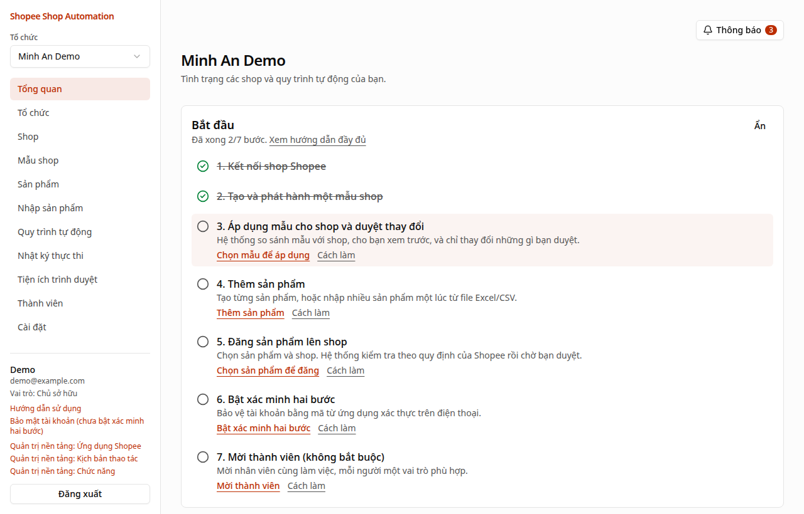
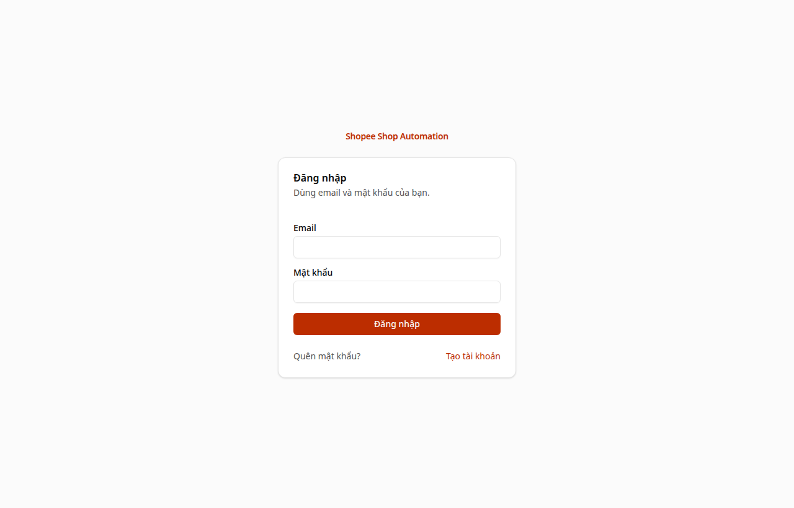
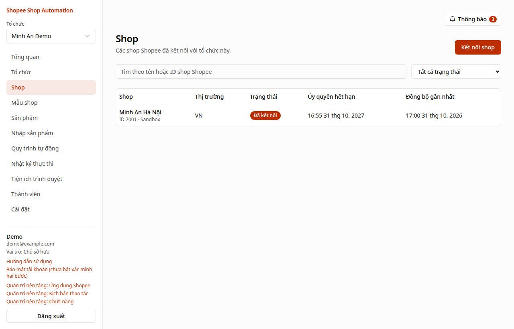
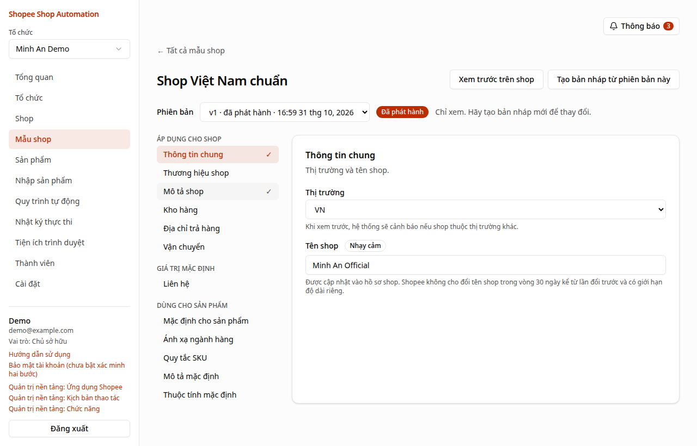
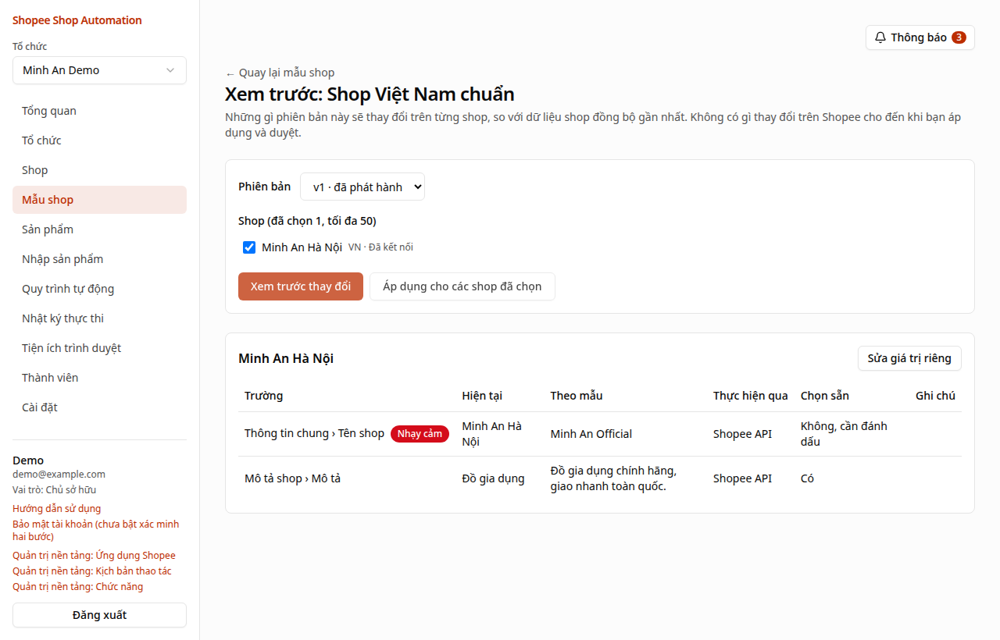
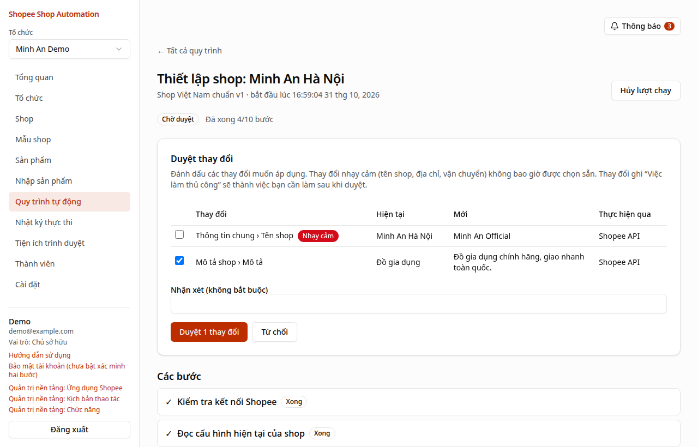
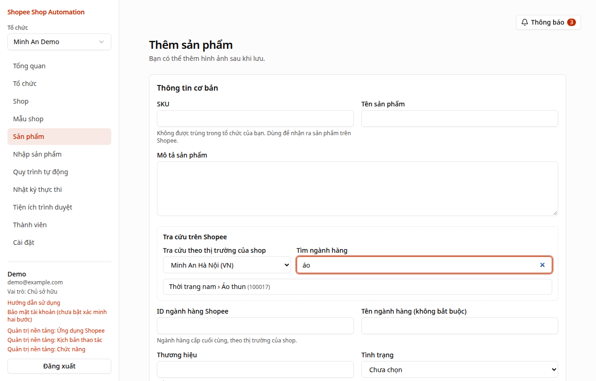
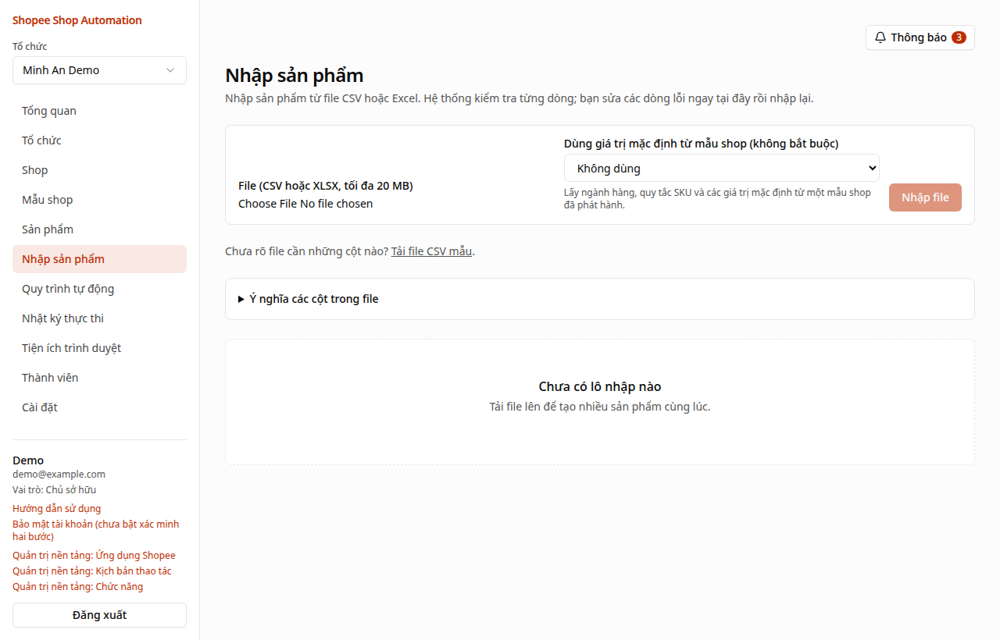
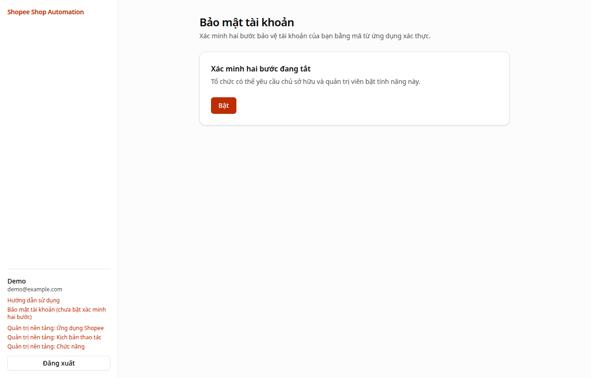

# Hướng dẫn sử dụng

Hướng dẫn này dành cho chủ shop và nhân viên bán hàng trên Shopee. Bạn không cần biết kỹ thuật: chỉ cần làm lần lượt từng bước. Trong hệ thống, trang **Tổng quan** có danh sách **Bắt đầu** đánh dấu sẵn bước nào bạn đã làm xong.

## Hệ thống giúp bạn làm gì {#gioi-thieu}

- **Thiết lập nhiều shop giống nhau trong một lần:** tên shop, mô tả, đơn vị vận chuyển, địa chỉ… được gom vào một **mẫu shop**, rồi áp dụng cho bao nhiêu shop cũng được.
- **Đăng sản phẩm hàng loạt:** tạo sản phẩm một lần (hoặc nhập từ file Excel), hệ thống kiểm tra theo quy định của Shopee rồi đăng lên các shop bạn chọn.
- **Bạn luôn là người quyết định:** trước khi thay đổi bất cứ điều gì trên Shopee, hệ thống cho bạn xem trước và chỉ làm những gì bạn **duyệt**.
- **Không đăng trùng sản phẩm:** dù mạng chập chờn hay bạn bấm lại nhiều lần, mỗi sản phẩm chỉ được tạo một lần trên mỗi shop.

## Các bước bắt đầu {#bat-dau}

1. [Tạo tài khoản và tổ chức](#tai-khoan)
2. [Kết nối shop Shopee](#ket-noi-shop)
3. [Tạo và phát hành một mẫu shop](#mau-shop)
4. [Áp dụng mẫu cho shop và duyệt thay đổi](#ap-dung-mau)
5. [Thêm sản phẩm](#san-pham) (hoặc [nhập từ file Excel/CSV](#nhap-san-pham))
6. [Đăng sản phẩm lên shop](#dang-san-pham)
7. [Bật xác minh hai bước](#bao-mat) để bảo vệ tài khoản

## 1. Tạo tài khoản và tổ chức {#tai-khoan}

1. Mở trang hệ thống, bấm **Tạo tài khoản**. Nhập **Tên của bạn**, **Email** và **Mật khẩu** (ít nhất 12 ký tự; một câu ngắn dễ nhớ là lựa chọn tốt, ví dụ `toi ban ao thun o ha noi`).
2. Mở hộp thư email, bấm vào liên kết **xác minh địa chỉ email**. Nếu không thấy, hãy xem thư mục Spam hoặc Quảng cáo.
3. **Đăng nhập** bằng email và mật khẩu vừa tạo.

   
4. Lần đầu đăng nhập, hệ thống mời bạn **tạo tổ chức**: nhập tên (thường là tên công ty hoặc tên thương hiệu) rồi bấm **Tạo tổ chức**.

> **Tổ chức là gì?** Là "không gian làm việc" chung của bạn và nhân viên. Shop, mẫu shop, sản phẩm đều thuộc về tổ chức. Một người có thể ở nhiều tổ chức; chuyển qua lại bằng ô **Tổ chức** ở góc trên bên trái.

## 2. Kết nối shop Shopee {#ket-noi-shop}

Kết nối cho phép hệ thống làm việc với shop thay bạn. Bạn đăng nhập Shopee và đồng ý cấp quyền; hệ thống **không bao giờ biết mật khẩu Shopee của bạn**.

1. Vào menu **Shop**, bấm **Kết nối shop**.
2. Trình duyệt chuyển sang trang Shopee. Đăng nhập bằng tài khoản người bán của shop cần kết nối và bấm đồng ý.
3. Shopee đưa bạn trở lại hệ thống. Shop xuất hiện với trạng thái **Đã kết nối**. Hệ thống tự đọc thông tin shop (tên, ngành hàng, đơn vị vận chuyển…).
4. Lặp lại cho từng shop. Nếu bạn dùng tài khoản chính quản lý nhiều shop, Shopee cho chọn nhiều shop cùng lúc; hệ thống sẽ hỏi bạn muốn thêm những shop nào.

**Trạng thái của shop:**

| Trạng thái | Ý nghĩa | Bạn cần làm gì |
|---|---|---|
| Đã kết nối | Mọi thứ bình thường | Không cần làm gì |
| Cần kết nối lại | Shopee không còn chấp nhận quyền cũ (ví dụ đổi mật khẩu, hết hạn) | Mở shop, bấm **Kết nối lại** |
| Người bán đã thu hồi / Ủy quyền đã hết hạn | Quyền đã bị gỡ trên Shopee | Bấm **Kết nối lại** |
| Đã ngắt kết nối | Bạn đã ngắt kết nối shop | Kết nối lại nếu cần dùng |

Quyền Shopee có thời hạn (thường 1 năm). Hệ thống báo trước khi hết hạn để bạn kết nối lại.

> **Không thấy nút kết nối hoạt động?** Thông báo "chưa có ứng dụng Shopee" nghĩa là người quản trị hệ thống chưa cài đặt kết nối với Shopee. Hãy liên hệ người quản trị (xem [Dành cho quản trị nền tảng](#quan-tri)).

## 3. Tạo và phát hành mẫu shop {#mau-shop}

**Mẫu shop** là bộ cấu hình bạn muốn mọi shop đều giống nhau: tên shop, mô tả, đơn vị vận chuyển, địa chỉ trả hàng, quy tắc SKU, giá trị mặc định cho sản phẩm…

1. Vào **Mẫu shop**, nhập **Tên mẫu shop mới** (ví dụ "Shop Việt Nam chuẩn") và bấm **Tạo mẫu shop**.
2. Bên trái là danh sách **mục** (Thông tin chung, Mô tả, Đơn vị vận chuyển, Địa chỉ trả hàng…). Bấm vào từng mục, điền những gì bạn muốn rồi bấm **Lưu mục**. Mục nào không cần thì bỏ trống: hệ thống sẽ không đụng tới phần đó của shop.

   
3. Bấm **Kiểm tra** để hệ thống rà lỗi. Khi thấy **Sẵn sàng phát hành**, bấm **Phát hành** và xác nhận.

> **Tại sao phải phát hành?** Bản đã phát hành được "khóa" lại để mọi shop nhận đúng cùng một nội dung. Muốn sửa, bấm **Tạo bản nháp từ phiên bản này**, sửa rồi phát hành phiên bản mới.

**Giá trị riêng cho từng shop:** nếu một shop cần khác một chút (ví dụ tên shop "Minh An Hà Nội" thay vì "Minh An"), ở bước xem trước bấm **Sửa giá trị riêng** cho shop đó. Những gì không sửa vẫn lấy theo mẫu.

## 4. Áp dụng mẫu cho shop và duyệt thay đổi {#ap-dung-mau}

1. Mở mẫu shop đã phát hành, bấm **Xem trước trên shop**.
2. Chọn các shop và bấm **Xem trước thay đổi**. Hệ thống đọc cấu hình hiện tại của từng shop trên Shopee và cho bạn thấy: **đang là gì** → **sẽ đổi thành gì**.

   
3. Bấm **Áp dụng cho các shop đã chọn** rồi **Bắt đầu thiết lập**. Mỗi shop chạy một **quy trình** riêng.
4. Vào **Quy trình tự động**, mở quy trình có trạng thái **Chờ duyệt**:
   - Tích chọn các thay đổi muốn áp dụng. Thay đổi quan trọng (tên shop, địa chỉ, vận chuyển) **không được chọn sẵn** để bạn xem kỹ.
   - Bấm **Duyệt N thay đổi** (hoặc **Từ chối** để hủy).

   
5. Hệ thống áp dụng các thay đổi qua Shopee rồi đọc lại để kiểm tra. Kết quả hiện trong phần **Báo cáo** của quy trình.

**Việc làm thủ công:** một số thứ Shopee không cho phép đổi tự động (banner shop, trang trí shop, kho hàng, tạo địa chỉ mới). Hệ thống liệt kê thành **việc làm thủ công** kèm hướng dẫn. Bạn làm trong **Kênh Người Bán** rồi bấm **Đánh dấu là xong**. Nếu đã cài [tiện ích trình duyệt](#tien-ich), một số việc này có thể tự làm.

> Người duyệt có thể khác người bắt đầu quy trình. Mặc định, nhân viên vận hành không tự duyệt quy trình của chính mình; chủ sở hữu có thể cho phép trong **Cài đặt**.

## 5. Thêm sản phẩm {#san-pham}

1. Vào **Sản phẩm**, bấm **Thêm sản phẩm**.
2. Điền **SKU** (mã sản phẩm của bạn, mỗi sản phẩm một mã riêng), **Tên sản phẩm**, mô tả, **Giá**, **Tồn kho**, **Cân nặng** và kích thước đóng gói.
3. **Ngành hàng, thuộc tính, thương hiệu:** dùng ô **Tra cứu trên Shopee** ngay trong biểu mẫu. Chọn một shop đã kết nối, gõ vài chữ để tìm ngành hàng (ví dụ "áo thun"), bấm chọn. Hệ thống hiện các **thuộc tính bắt buộc** và danh sách **thương hiệu** của ngành hàng đó để bạn chọn.

   
4. **Phân loại hàng** (màu, size…): bấm **Thêm nhóm phân loại**, nhập tên nhóm và các lựa chọn, rồi điền giá, tồn kho cho từng phân loại.
   > Shopee chỉ chấp nhận **tên phân loại chuẩn** của ngành hàng (ví dụ "Màu sắc", "Kích cỡ") và các lựa chọn có trong danh sách của Shopee. Nếu bạn nhập khác, hệ thống sẽ báo khi kiểm tra trước lúc đăng.
5. Bấm **Tạo sản phẩm**, sau đó **thêm ảnh** (JPEG, PNG hoặc WebP, tối đa 10 MB mỗi ảnh; ảnh đầu tiên là ảnh bìa).

## 6. Nhập sản phẩm từ file Excel/CSV {#nhap-san-pham}

Phù hợp khi bạn có nhiều sản phẩm.

1. Vào **Nhập sản phẩm**, bấm **Tải file CSV mẫu** để có file đúng định dạng. Mở bằng Excel hoặc Google Sheets.

   
2. Mỗi dòng là một sản phẩm (hoặc một phân loại của sản phẩm). **Giữ nguyên tên các cột** (viết bằng tiếng Anh, ví dụ `sku`, `name`, `price`). Trang **Nhập sản phẩm** có bảng giải thích ý nghĩa từng cột.
   - Sản phẩm có nhiều phân loại: viết nhiều dòng **cùng SKU**, mỗi dòng một phân loại.
   - Ảnh: cột `image_urls` là đường link ảnh (bắt đầu bằng `https://`), nhiều link cách nhau bằng dấu `|`.
   - Nếu chọn **mẫu shop** khi nhập, hệ thống tự điền ngành hàng, cân nặng, SKU… còn thiếu theo mẫu.
3. Lưu file dạng CSV (UTF-8) hoặc Excel (.xlsx), tối đa 20 MB. Chọn file và bấm **Nhập file**.
4. Hệ thống kiểm tra **từng dòng**. Dòng hợp lệ được tạo thành sản phẩm; dòng có lỗi được tô màu kèm lý do ở đúng cột.
5. Sửa ngay trên trang: bấm **Sửa** ở dòng lỗi, chỉnh rồi **Lưu**. Khi xong, bấm **Nhập lại các dòng đã sửa**. Bạn có thể **Tải báo cáo** để xem toàn bộ kết quả.

> Nhập lại cùng SKU sẽ **cập nhật** sản phẩm đã có, không tạo bản sao.

## 7. Đăng sản phẩm lên shop {#dang-san-pham}

1. Vào **Sản phẩm**, tích chọn các sản phẩm, bấm **Đăng N sản phẩm đã chọn** (hoặc từ một lô nhập: **Đăng các sản phẩm đã nhập**).
2. Chọn shop. Chọn sau khi tạo sản phẩm sẽ **Ẩn (chưa hiển thị)** để bạn kiểm tra lại trong Kênh Người Bán, hay **hiển thị và mở bán ngay**. Bấm **Kiểm tra và đăng**.
3. Hệ thống kiểm tra từng sản phẩm theo quy định của từng shop: ngành hàng, thuộc tính bắt buộc, thương hiệu, tiền tệ, đơn vị vận chuyển, phân loại chuẩn. Sản phẩm **chưa đạt** được liệt kê kèm lý do cụ thể.
4. Mở quy trình **Chờ duyệt**, tích chọn các sản phẩm muốn đăng và bấm **Đăng N sản phẩm**.
5. Theo dõi từng sản phẩm trong quy trình. Trên trang sản phẩm, mục **Trên Shopee** cho biết sản phẩm đã có trên shop nào và mã sản phẩm Shopee.

**Sản phẩm bị chặn?** Đọc lý do (ví dụ "thiếu thuộc tính bắt buộc Chất liệu"), sửa sản phẩm rồi đăng lại. Sản phẩm đã đăng thành công sẽ không bị đăng lần hai.

## 8. Theo dõi quy trình, thông báo và xử lý lỗi {#quy-trinh}

- **Quy trình tự động** liệt kê mọi lượt chạy. Bấm vào để xem từng bước, lỗi (nếu có) và nhật ký.
- **Thông báo** (nút chuông ở góc trên bên phải) báo khi có việc chờ duyệt, quy trình cần bạn xử lý, quy trình thất bại hoặc shop cần kết nối lại.
- **Tổng quan** có mục **Cần chú ý** gom những việc đang chờ bạn.

| Trạng thái quy trình | Bạn cần làm gì |
|---|---|
| Đang chạy / Đang chờ | Không cần làm gì |
| Chờ duyệt | Mở quy trình, chọn thay đổi và duyệt |
| Chờ bạn xử lý | Làm việc thủ công rồi **Đánh dấu là xong**, hoặc **Kết nối lại** shop rồi bấm **Tiếp tục** |
| Hoàn tất một phần / Thất bại | Đọc lỗi; sửa nguyên nhân rồi bấm **Thử lại các bước thất bại** (chỉ chạy lại phần lỗi) |
| Hoàn tất | Xem báo cáo |

## 9. Tiện ích trình duyệt (không bắt buộc) {#tien-ich}

Một số thao tác Shopee không cho làm tự động qua kết nối (banner, trang trí shop…). **Tiện ích trình duyệt** làm giúp bạn ngay trong trình duyệt của bạn, khi bạn đang mở Kênh Người Bán và có mặt để theo dõi.

1. Cài tiện ích vào Chrome, Edge hoặc Cốc Cốc (người quản trị sẽ gửi bạn đường dẫn cài đặt).
2. Vào **Tiện ích trình duyệt** trong hệ thống, bấm **Tạo mã ghép nối**. Mở tiện ích, nhập mã (có hiệu lực 6 phút, dùng một lần).
3. Khi có việc, tiện ích hiện danh sách. Mở Kênh Người Bán **đúng shop** đó, bấm **Chạy**. Tiện ích luôn kiểm tra đúng shop trước khi làm.
4. Nếu Shopee hỏi đăng nhập, mã OTP hay CAPTCHA, tiện ích **dừng lại chờ bạn**. Bạn tự làm xong rồi bấm **Tiếp tục**. Muốn dừng hẳn, bấm **Dừng**.

Tiện ích không đọc mật khẩu hay cookie Shopee của bạn. Việc nào chưa có kịch bản thao tác đã được kiểm chứng thì vẫn là việc làm thủ công.

## 10. Bảo mật tài khoản {#bao-mat}

**Xác minh hai bước** bảo vệ tài khoản kể cả khi người khác biết mật khẩu của bạn.

1. Cài một **ứng dụng xác thực** trên điện thoại (Google Authenticator, Microsoft Authenticator, 1Password…).
2. Trong hệ thống, bấm **Bảo mật tài khoản** (góc dưới bên trái), bấm **Bật**.

   
3. Trong ứng dụng xác thực, thêm tài khoản bằng **khóa** hiện trên màn hình. Nhập **Mã** 6 số mà ứng dụng hiện ra, bấm **Xác nhận**.
4. Hệ thống hiện 10 **mã khôi phục**. **Hãy lưu lại** (in ra hoặc lưu ở nơi an toàn): khi mất điện thoại, mỗi mã dùng được một lần để đăng nhập.

Từ đó, khi đăng nhập bạn nhập thêm **Mã xác minh** từ ứng dụng. Chủ sở hữu có thể bắt buộc mọi chủ sở hữu và quản trị viên của tổ chức dùng xác minh hai bước trong **Cài đặt**.

## 11. Thành viên và vai trò {#thanh-vien}

Vào **Thành viên**, nhập email, chọn vai trò và bấm **Gửi lời mời**. Người được mời nhận email và bấm vào liên kết để tham gia.

| Vai trò | Được làm gì |
|---|---|
| Chủ sở hữu | Toàn quyền, kể cả xóa tổ chức và chuyển quyền sở hữu |
| Quản trị viên | Mọi việc trừ xóa tổ chức và chuyển quyền sở hữu; quản lý thành viên |
| Nhân viên vận hành | Làm mẫu shop, sản phẩm, nhập file, chạy và duyệt quy trình, đồng bộ shop (không kết nối hay ngắt kết nối shop) |
| Người xem | Chỉ xem |

## 12. Câu hỏi thường gặp {#cau-hoi}

**Hệ thống có tự thay đổi shop của tôi mà không hỏi không?**
Không. Mọi thay đổi trên Shopee đều phải qua bước **duyệt**.

**Tôi lỡ bấm đăng sản phẩm hai lần, có bị trùng không?**
Không. Mỗi sản phẩm chỉ được tạo một lần trên mỗi shop; lần sau hệ thống nhận ra và bỏ qua.

**Nhập file báo "Ngành hàng không tồn tại" hoặc "Thiếu thuộc tính bắt buộc"?**
Dùng ô **Tra cứu trên Shopee** trong trang sản phẩm để tìm đúng mã ngành hàng và thuộc tính, hoặc thêm bảng ánh xạ ngành hàng trong **mẫu shop** (mục Ánh xạ ngành hàng) để hệ thống tự đổi tên ngành hàng của bạn sang mã Shopee.

**Shop chuyển sang "Cần kết nối lại"?**
Mở shop và bấm **Kết nối lại**, đăng nhập Shopee bằng đúng shop đó. Các quy trình đang chờ sẽ tiếp tục khi bạn bấm **Tiếp tục**.

**Không nhận được email?**
Xem thư mục Spam. Trên thanh thông báo vàng (khi chưa xác minh email) có nút **Gửi lại liên kết**. Quên mật khẩu: bấm **Quên mật khẩu?** ở trang đăng nhập.

**Mất điện thoại có ứng dụng xác thực?**
Đăng nhập bằng một **mã khôi phục** thay cho mã 6 số, rồi tắt và bật lại xác minh hai bước với điện thoại mới.

## Dành cho quản trị nền tảng {#quan-tri}

Phần này dành cho người cài đặt và vận hành hệ thống (thường là bộ phận kỹ thuật), làm **một lần**:

1. Đăng ký tài khoản nhà phát triển tại Shopee Open Platform và tạo ứng dụng (loại ERP System). Shopee cấp **Partner ID** và **Partner key**.
2. Trong hệ thống, tài khoản quản trị nền tảng vào **Quản trị nền tảng: Ứng dụng Shopee**, thêm ứng dụng với Partner ID, Partner key và môi trường (Sandbox để thử, Production để chạy thật). Hệ thống hiển thị địa chỉ nhận thông báo (push) để khai báo trong Shopee Console.
3. Từ đó người dùng có thể bấm **Kết nối shop**.

Hướng dẫn cài đặt máy chủ, sao lưu và vận hành (tiếng Anh, dành cho kỹ thuật): `docs/deployment.md`, `docs/runbooks.md`, `docs/development.md`.
