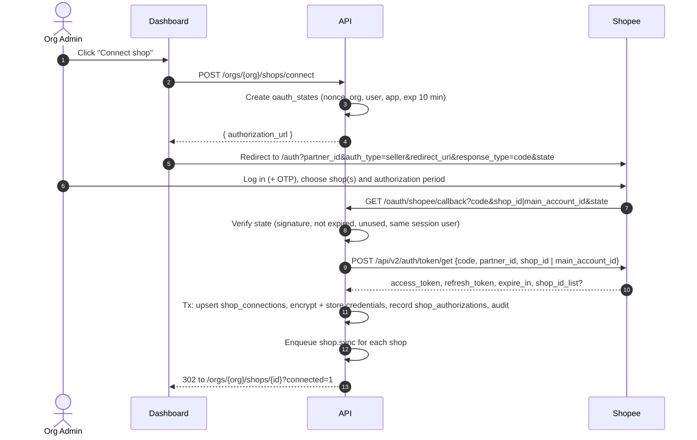

# Shopee Integration — Shopee Shop Automation

Status: Phase 2 implemented (doc-verified only) · Docs verified: 2026-10-30

## 1. Sources and verification method

All facts below were read from the official Shopee Open Platform documentation on **2026-10-30**:

- Developer guides: [API calls](https://open.shopee.com/developer-guide/16), [Authorization and Authentication](https://open.shopee.com/developer-guide/20), [Push Mechanism](https://open.shopee.com/developer-guide/18), [Sandbox Testing V2](https://open.shopee.com/developer-guide/644), [Product creation preparation](https://open.shopee.com/developer-guide/209), [Creating product](https://open.shopee.com/developer-guide/211), [Variant management](https://open.shopee.com/developer-guide/219), [Terms of Service](https://open.shopee.com/developer-guide/36), [Platform Partner Rules](https://open.shopee.com/developer-guide/34).
- API reference pages: `https://open.shopee.com/documents/v2/<api_name>?module=<id>&type=1`. The machine-readable version the docs site itself loads is `https://open.shopee.com/opservice/api/v1/doc/api/?version=2&api_name=<api_name>`. It gives the path, method, API type, request/response parameters and the app types allowed to call it.

**Not verified yet (needs a registered app and sandbox access):** actual responses, error codes in practice, throttling behavior, region-specific availability, which `scene` value `update_profile.shop_logo` expects. Each item in §7 carries a status: `DOC-VERIFIED` (read in official docs) or `SANDBOX-VERIFIED` (called successfully in sandbox). **Nothing is `SANDBOX-VERIFIED` yet.** A capability is only enabled in production after it reaches `SANDBOX-VERIFIED`.

Rule: if an endpoint, field or permission is not in the official docs, it is not implemented. The code keeps an interface and returns `ErrCapabilityUnavailable`.

## 2. Environments and hosts

| Environment | API host | Authorization page |
|---|---|---|
| Production, SG-deployed servers | `https://partner.shopeemobile.com` | `https://open.shopee.com/auth` |
| Production, US-deployed servers | `https://openplatform.shopee.com.br` | `https://open.shopee.com.br/auth` (Brazil) |
| Production, Mainland China servers | `https://openplatform.shopee.cn` | `https://open.shopee.cn/auth` |
| Sandbox (global) | `https://openplatform.sandbox.test-stable.shopee.sg` | `https://open.sandbox.test-stable.shopee.com/auth` |
| Sandbox (Mainland China) | `https://openplatform.sandbox.test-stable.shopee.cn` | `https://open.sandbox.test-stable.shopee.cn/auth` |

Notes:
- The API host is chosen by **where our servers run**, not by the seller's market. With a Singapore deployment we use `partner.shopeemobile.com` for every market (assumption A-3).
- Test partner IDs only work in sandbox; live partner IDs only in production. One `shopee_apps` row per (environment, partner ID).
- Hosts are stored per `shopee_apps` row, never hardcoded.
- Some API reference pages still show `partner.test-stable.shopeemobile.com` as a test URL. The current Sandbox V2 guide lists the hosts above; we follow the guide and confirm in sandbox.

## 3. Request signing

Every call carries `partner_id`, `timestamp` (Unix seconds, valid **5 minutes**) and `sign` as query parameters. Shop APIs add `access_token` and `shop_id`; merchant APIs add `access_token` and `merchant_id`.

`sign = hex(HMAC-SHA256(key = partner_key, msg = base_string))`, lowercase hex.

| API type | Base string (concatenate, no separators) |
|---|---|
| Public | `partner_id` + `api_path` + `timestamp` |
| Shop | `partner_id` + `api_path` + `timestamp` + `access_token` + `shop_id` |
| Merchant | `partner_id` + `api_path` + `timestamp` + `access_token` + `merchant_id` |

`api_path` is the path without host or query, e.g. `/api/v2/shop/get_shop_info`.

Official example (used as a unit-test vector, expected sign to be computed in the test since the guide does not give the partner key for it):

```
partner_id = 2001887, path = /api/v2/shop/get_shop_info, timestamp = 1655714431,
access_token = 59777174636562737266615546704c6d, shop_id = 14701711
base = "2001887/api/v2/shop/get_shop_info165571443159777174636562737266615546704c6d14701711"
```

Request shape:
- **GET:** common + request parameters in the query string.
- **POST:** common parameters in the query string, request parameters as a JSON body (`Content-Type: application/json`). File uploads (`media_space.upload_image`) use `multipart/form-data`.

Go design:

```go
package signer

type Kind int // Public, Shop, Merchant

func Sign(partnerKey []byte, partnerID int64, path string, ts int64, kind Kind, accessToken string, targetID int64) string
```

Pure function, no I/O, table-tested. The client takes the timestamp from an injected clock and **re-signs on every retry** (a retry after 5 minutes would otherwise fail).

## 4. Token lifecycle

### 4.1 Facts from the docs

| Item | Value |
|---|---|
| Authorization `code` | Single-use, expires after **10 minutes** |
| `access_token` | Reusable, expires after **4 hours** (`expire_in` in seconds) |
| `refresh_token` | **Single-use**, valid **30 days**; each refresh returns a new one |
| Authorization period | Chosen by the seller (7/30/90/180/365 days or custom), **max 365 days**. After it ends, the seller must re-authorize. Refresh must happen inside this period. |
| Re-authorization | Issues a new access and refresh token |
| Main account | One authorization can cover several shops/merchants; `token/get` returns `shop_id_list` / `merchant_id_list` |
| SIP | Authorizing a CB SIP primary shop also authorizes its linked shops, with limited permissions (out of scope v1) |

### 4.2 Connect flow



- The new auth link format (`/auth?partner_id&auth_type=seller&redirect_uri&response_type=code&state`) supports `state`, which we use for CSRF. The legacy `/api/v2/shop/auth_partner` link (signed, 5-minute timestamp) is supported as a fallback only.
- `redirect_uri` must match the **Redirect URL Domain** configured in the Shopee Console for that environment.
- For a main-account authorization that returns several shops, the callback lists them and the user picks which to attach to the organization. Unselected shops are not stored.

### 4.3 Refresh

Trigger: scheduler every 5 minutes selects credentials with `access_expires_at < now() + 30 min` (via `app_system`) and enqueues `shopee.token.refresh` per shop (task ID = `refresh:{connection_id}:{access_expires_at}` so duplicates collapse). Calls made just-in-time also refresh when the token has < 5 minutes left.

```
BEGIN
  SELECT ... FROM shop_credentials WHERE shop_connection_id = $1 FOR UPDATE   -- serializes refreshers
  IF access_expires_at > now() + 30min: COMMIT, return (someone else refreshed)
  call POST /api/v2/auth/access_token/get {refresh_token, partner_id, shop_id}   (timeout 10 s)
  ON success: UPDATE credentials SET new tokens, version = version + 1; INSERT shop_authorizations(REFRESHED)
  ON definitive auth error: UPDATE shop_connections SET status = 'RECONNECT_REQUIRED'; notify
  ON network error / 5xx: leave tokens unchanged; retry with backoff (old refresh token still valid)
COMMIT
```

- Holding a row lock across a 10-second HTTP call is acceptable at this volume (one row per shop, short timeout). It removes the need for a separate Redis lock and is correct even if Redis is down.
- **Ambiguous outcome risk:** if Shopee rotates the token but our commit fails (or the response is lost), the old refresh token is dead. Mitigations: commit the new token immediately and do nothing else in that transaction; on commit failure, retry the write from memory (bounded); if still failing, mark `RECONNECT_REQUIRED` and alert. The docs mention a recovery FAQ for lost tokens and `v2.public.get_token_by_resend_code`; its exact flow must be read before relying on it (open item S-3).
- Refresh tokens expire after 30 days even if unused, so the scheduler refreshes every shop at least daily, which keeps both tokens fresh.

### 4.4 Authorization expiry, revocation, reconnection

| Signal | Source | Action |
|---|---|---|
| `authorization_expires_at` within 7 days | Push code 12, plus daily `public.get_shops_by_partner` (returns `expire_time` per shop) | Notify org admins with a reconnect link |
| Authorization expired | `expire_time` passed or auth error on call | `EXPIRED`; pause dependent workflows (`WAITING_USER`) |
| Seller revoked | Push code 2 (Shop Authorization Canceled) | `REVOKED`; delete credentials; pause workflows; audit |
| Seller authorized (incl. via main account) | Push code 1 | Reconcile shop list; if a pending `oauth_states` matches, finish the connection |
| Refresh rejected | Error from `access_token/get` | `RECONNECT_REQUIRED` |
| User disconnects in our app | UI | Delete credentials, `DISCONNECTED`; data purge job per retention (Shopee ToS requires deleting Shopee content within 14 days after termination) |

Reconnecting uses the same connect flow. If `(shopee_app_id, shopee_shop_id)` already exists in the **same** org, the row is reused and history is kept.

## 5. Token storage and encryption

- `shop_credentials.access_token_enc` and `refresh_token_enc` are AES-256-GCM ciphertext under a per-row data key (`dek_wrapped`), wrapped by a KEK identified by `kek_id`.
- AAD = `"shop_credentials|" + connection_id + "|" + column`.
- `shopee_apps.partner_key_enc` uses the same scheme.
- KEK rotation: add new KEK → new writes use it → background job re-wraps DEKs (`kek_id` filter) → retire old KEK after zero rows remain. No downtime.
- Decrypted tokens exist only in memory in the Shopee client, never in logs, errors, traces, task payloads or API responses. The logger redacts known keys, and the HTTP client strips query strings from span attributes and error messages (tokens and signs travel in the query string).

## 6. Client behavior

### 6.1 Error normalization

Shopee responses carry `request_id`, `error` (empty on success), `message`, optional `warning` and `response`. The client maps them to:

```go
type Error struct {
    Kind      Kind   // Auth, Permission, Validation, NotFound, RateLimited, Transient, Unknown
    Code      string // Shopee `error`, e.g. "error_auth", "error_param"
    Message   string // Shopee `message`, safe to show
    RequestID string // for support tickets
    HTTPStatus int
}
```

Mapping is driven by a table in code. Known codes from the docs: `error_auth`, `error_param`, `error_data`, `error_network`, `error_not_exists`, `error_permission` (to confirm). The table only grows from observed or documented codes. Unknown codes are `Unknown` and treated as non-retryable unless HTTP status is 5xx. A non-empty `warning` on success is surfaced as a step warning (it often means partial batch failure, e.g. `update_stock` `failure_list`).

### 6.2 Rate limiting and retries

The docs metadata shows no per-endpoint limits (`rate_limit: [0,0,0]`), but the ToS forbids "excessive or abusive usage". Defaults:
- Token bucket in Redis per `(shopee_app_id)` (global, e.g. 50 req/s) and per `(shop)` (e.g. 5 req/s), both configurable.
- Retry on network errors, HTTP 5xx and throttling responses: exponential backoff with full jitter, max 5 attempts, re-signing each time.
- **Never auto-retry a non-idempotent write after an ambiguous failure** (timeout after the request was sent). The step becomes `AMBIGUOUS` and the workflow reconciles first (see workflow-design.md).

### 6.3 Webhooks (Push Mechanism)

- Endpoint: `POST /webhooks/shopee/{app_id}`. Configured in Shopee Console or via `v2.push.set_app_push_config`.
- Verify: `Authorization` header = `hex(HMAC-SHA256(partner_key, callback_url + "|" + raw_body))`, constant-time compare. The URL must be the exact public URL Shopee calls.
- Respond **2xx with an empty body** quickly. Failed or slow responses are retried by Shopee, and a low success rate leads to warning emails and eventually disabling push for the app.
- Store first (`webhook_events`, dedupe on body hash), acknowledge, then process on the worker.
- Recovery: `v2.push.get_lost_push_message` + `v2.push.confirm_consumed_lost_push_message` on a schedule.
- Optional source-IP check using `v2.public.get_shopee_ip_ranges`.
- Codes used in v1: **1** (authorization), **2** (authorization canceled), **12** (authorization expiring in 7 days).

## 7. API capability matrix

Legend: Mode = execution mode at launch. Approval = needs explicit user approval inside a workflow. Status: all rows are `DOC-VERIFIED` only (sandbox pending).

| Capability | Mode | Shopee API(s) (method, path) | Approval | Notes |
|---|---|---|---|---|
| `shop.info.read` | API | GET `/api/v2/shop/get_shop_info` | No | shop_name, region, status, is_cb, is_sip, merchant_id, auth_time, expire_time |
| `shop.profile.read` | API | GET `/api/v2/shop/get_profile` | No | shop_logo, description, shop_name |
| `shop.profile.update` | API | POST `/api/v2/shop/update_profile` (`shop_name`, `shop_logo`, `description`) | **Yes** | Shop name is *sensitive*; Shopee may limit name changes (unverified) |
| `shop.avatar.upload` | API | POST `/api/v2/media_space/upload_image` → POST `/api/v2/shop/update_profile` (`shop_logo` URL) | **Yes** | Which `scene` to use for a logo is unverified (S-4) |
| `shop.banner.upload` | **BROWSER** (fallback MANUAL) | — none found in Shop module | Yes | No Open API for banners. Runs through the browser extension |
| `shop.decoration.update` | **BROWSER** (fallback MANUAL) | — none found | Yes | Shop decoration page; extension recipe |
| `shop.warehouse.read` | API | GET `/api/v2/shop/get_warehouse_detail` | No | Only meaningful for multi-warehouse shops |
| `shop.warehouse.update` | **BROWSER** (fallback MANUAL) | — none found | Yes | Extension recipe |
| `shop.address.read` | API | GET `/api/v2/logistics/get_address_list` | No | Pickup/return addresses |
| `shop.address.update` | API | POST `/api/v2/logistics/update_address` | **Yes** | Edits an existing address by `address_id`; creation has no API → `shop.address.create` = BROWSER (fallback MANUAL). Treated as *user-managed* |
| `shop.address.config` | API | POST `/api/v2/logistics/set_address_config` | **Yes** | Sets which address is default/pickup/return |
| `shop.logistics.read` | API | GET `/api/v2/logistics/get_channel_list` | No | Also provides `fee_type` and size options needed for products |
| `shop.logistics.update` | API | POST `/api/v2/logistics/update_channel` (`logistics_channel_id`, `enabled`, `cod_enabled`) | **Yes** | COD is *sensitive* |
| `shop.holiday_mode.update` | API | POST `/api/v2/shop/set_shop_holiday_mode` | Yes | Not in template v1. Only the API name was seen in the module list; params not yet read |
| `shop.category.manage` | API | `/api/v2/shop_category/*` | Yes | Shop's own showcase categories; template v2 candidate. Only API names seen; params not yet read |
| `product.category.read` | API | GET `/api/v2/product/get_category`, GET `/api/v2/product/category_recommend` | No | Leaf categories only for `add_item` |
| `product.attribute.read` | API | GET `/api/v2/product/get_attribute_tree` (`category_id_list`), GET `/api/v2/product/get_brand_list` | No | `mandatory` attributes; brand `is_mandatory` |
| `product.limits.read` | API | GET `/api/v2/product/get_item_limit` | No | Name/description/image/price/stock limits per category |
| `product.image.upload` | API | POST `/api/v2/media_space/upload_image` (multipart, `image`, `scene` = `normal`/`desc`) | No | ≤ 10 MB per image, fewer than 9 images per call, returns `image_id` |
| `product.create` | API | POST `/api/v2/product/add_item` | Workflow-level | Requires `original_price`, `description`, `weight`, `item_name`, `logistic_info`, `category_id`, `image.image_id_list`; brand when mandatory |
| `product.variation.create` | API | POST `/api/v2/product/init_tier_variation`, POST `/api/v2/product/add_model` | Workflow-level | Wait ≥ 5 s after `add_item`; max 2 tiers |
| `product.update` | API | POST `/api/v2/product/update_item`, POST `/api/v2/product/update_tier_variation` | Yes | |
| `product.price.update` | API | POST `/api/v2/product/update_price` | Yes | Returns `success_list` / `failure_list` |
| `product.stock.update` | API | POST `/api/v2/product/update_stock` | Yes | One item per call, `seller_stock` only; must stay ≥ promotion reserved stock |
| `product.read` | API | GET `/api/v2/product/get_item_list`, `get_item_base_info`, `get_model_list`, `search_item` (`item_sku`) | No | `search_item` is used for duplicate reconciliation |
| `product.batch_create` | **UNSUPPORTED (v1)** | POST `/api/v2/product/batch_add_item` + GET `get_batch_task_result` | — | Exists; evaluate in Phase 5 for throughput |

Required app permission: all rows above list **ERP System** among allowed app types in the docs metadata, matching assumption A-1. The registry stores the exact list per endpoint so a different app type is handled automatically.

Market: the docs do not mark these endpoints as region-restricted, but categories, attributes, logistics channels and limits differ per market. `supported_regions` starts as the v1 launch list and is narrowed after sandbox tests.

## 8. Browser automation policy

Shopee's **Platform Partner Rules** list "using web crawlers for collection of any Shopee-related data" and "abuse of internal API" as prohibited, and the **Terms of Service** forbid circumventing access limits. Penalties include deleting the Open Platform account.

Decision Q-1 (2026-10-30): operations without an API run through a **browser extension in the seller's own browser**. The guardrails that keep it a seller-operated tool (UI actions only, no internal API calls, no data collection, seller present and confirming, stop on every security challenge, kill switch) are in [browser-extension.md §2](browser-extension.md#2-compliance-guardrails). The extension never uses the partner app's credentials, so a problem with it cannot affect the Open API connection directly.

## 9. Testing approach

- Signer: table tests including the official base-string example; property test that any change to a field changes the sign.
- Client: `httptest.Server` emulating Shopee responses and errors; tests for re-signing on retry, redaction of query strings, error mapping, and that no retry happens after an ambiguous write.
- Token refresh concurrency: 50 goroutines refresh the same shop against a fake server that rejects reused refresh tokens; assert exactly one upstream refresh and all callers see the new token.
- Webhooks: signature verification with known vectors, dedupe, empty-body 2xx response.
- Sandbox E2E (manual trigger in CI, never on PRs): uses sandbox test shops only; no production credentials anywhere in CI.

## 10. Phase 2 implementation status

Implemented and tested against an in-process fake that follows the documented contract (signatures, 5-minute timestamps, single-use codes and refresh tokens, documented error codes and response shapes). Status of every item: `DOC-VERIFIED`.

| Area | What exists | Where |
|---|---|---|
| Signing | Public / Shop / Merchant base strings, official example as test vector | `internal/shopee/signer` |
| Client | Re-sign per attempt; retries for reads on transient errors, for all calls on connection refused / DNS failure and on `error_rate_limit` / HTTP 429; writes that may have reached Shopee become `KindAmbiguous` and are not retried; per-app and per-shop limits in Redis (fail open); errors and spans carry the path, never the URL | `internal/shopee/client.go` |
| Error mapping | Table of documented codes (from the error lists of `auth/token/get`, `auth/access_token/get`, `shop/get_shop_info` and the common list) → transient, rate limited, auth, authorization lost, app config, permission, validation, not found | `internal/shopee/errors.go` |
| Endpoints | `auth/token/get` (shop or main account), `auth/access_token/get`, `shop/get_shop_info`, `shop/get_profile`, auth link, push signature | `internal/shopee/api.go` |
| Flows | Connect, reconnect (same shop only), main-account selection, just-in-time and scheduled refresh, sync, disconnect, pushes 1/2/12 | `internal/shops` |

Findings while reading the reference (handled in code, to confirm in sandbox):
- `token/get` describes `expire_in` as seconds, but its sample shows a Unix timestamp. Both forms are accepted, capped at the documented 4 hours.
- The code 2 push samples use both `shop_id` and `shopid` inside `data`; both are read.
- Main account: the guide says the first `access_token`/`refresh_token` are identical for all authorized shops and each shop then refreshes on its own. Each attached shop therefore stores the same initial pair.
- `error_auth` is also documented for unrelated messages ("System error", stock rules), so it maps to `auth`, not to "authorization lost". Only the refresh-specific codes (`error_shop_refresh_token`, `refresh_token_expired`, `shop_access_expired`, `shop_no_linked`, …) mark a shop `RECONNECT_REQUIRED`.
- Push delivery: timeout 3 s, retries after 300, 1800 and 10800 seconds (push reference metadata). The receiver stores and answers before any processing.

## 11. Open items

| ID | Item | Blocks |
|---|---|---|
| S-1 | Register the Shopee developer account and app; get sandbox partner ID/key | All `SANDBOX-VERIFIED` statuses, Phase 2 E2E |
| S-2 | Confirm the app type (ERP System) is approved for our use case | Production go-live |
| S-3 | Read the "lost tokens" FAQ and `get_token_by_resend_code` flow | Refresh failure recovery |
| S-4 | Confirm the `scene` for shop logo upload and whether `update_profile` accepts a `media_space` URL | `shop.avatar.upload` |
| S-5 | Observe real throttling errors and codes | Rate-limit tuning |
| S-6 | Confirm whether an `image_id` is reusable across shops | Image upload cost |
| S-7 | Recipe verification per market (E-1…E-4 in browser-extension.md) | Phase 6 |
| S-8 | Check whether the Console's push URL verification request carries a valid `Authorization` signature. The receiver answers `401` to unsigned requests, which could make the Console's "Verify" button fail | Push setup in sandbox |
| S-9 | Confirm the `expire_in` unit of `token/get` and the `shopid` key in code 2 pushes | Sandbox |
