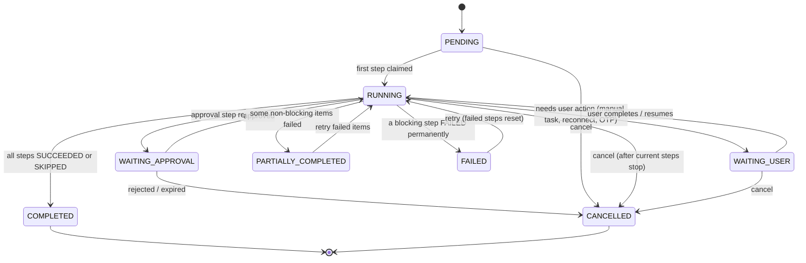
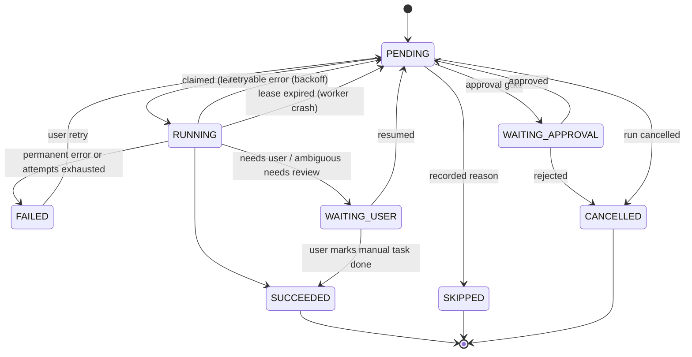

# Workflow Engine Design — Shopee Shop Automation

Status: Phase 4 implemented · Last updated: 2026-10-30

## 1. Principles

1. **PostgreSQL is the source of truth.** A run's state can be rebuilt from `workflow_runs`, `workflow_steps`, `workflow_step_attempts` and `workflow_events` alone. Redis/Asynq only delivers "please work on step X".
2. **At-least-once delivery, exactly-once effect.** Tasks may be delivered twice. Step claiming is a conditional `UPDATE`, and every external side effect has an idempotency strategy.
3. **Steps are small and explicit.** One external effect per step where possible, so retries and partial completion are precise.
4. **No silent skips.** A step only becomes `SKIPPED` for a recorded reason (user deselected the change, capability `UNSUPPORTED`, nothing to change). The reason is shown in the UI.

## 2. Concepts

| Concept | Meaning |
|---|---|
| Definition | Versioned, code-registered list of step specs (`SHOP_SETUP` v1). Stored in `workflow_definitions` for display and history; the Go code is authoritative. |
| Run | One execution of a definition against one shop. |
| Step | One unit of work. May **fan out** into per-item steps (e.g. one `create_product` step per product) using `item_key`. |
| Attempt | One try of a step, with outcome, error and trace ID. |
| Approval | A gate that stops the run until a user approves or rejects, with the exact diff they saw. |
| Event | Append-only log entry for every transition and notable message. |

Step spec (Go):

```go
type StepSpec struct {
    Key          string
    Capability   string        // "" for internal steps; resolved via registry otherwise
    DependsOn    []string
    Timeout      time.Duration
    Retry        RetryPolicy   // MaxAttempts, BaseDelay, MaxDelay; full jitter
    Approval     ApprovalSpec  // none | required | required-if-sensitive
    FanOut       FanOutFunc    // optional: returns item keys from earlier outputs
    Handler      StepHandler
    Compensate   StepHandler   // optional
    ContinueOnFailure bool     // allows PARTIALLY_COMPLETED instead of FAILED
}

type StepHandler func(ctx context.Context, s StepContext) (Result, error)
```

Handlers return a typed result: `Succeeded(output)`, `Retryable(err)`, `Permanent(err)`, `Ambiguous(err)`, `WaitUser(reason, instructions)`, `Skip(reason)`.

## 3. State machines

### 3.1 Run



### 3.2 Step



Transitions are implemented in one pure function `Transition(current, event) (next, error)` with an exhaustive table test. Illegal transitions are errors, never silent no-ops.

## 4. Execution

```mermaid
sequenceDiagram
  autonumber
  participant API
  participant PG as PostgreSQL
  participant Q as Asynq/Redis
  participant W as Worker
  participant SW as Sweeper
  API->>PG: Tx: insert run + initial steps (PENDING), event RUN_CREATED
  API->>Q: enqueue step.execute{step_id} (after commit)
  Q->>W: deliver
  W->>PG: claim: UPDATE ... SET RUNNING, lease_token, lease_expires_at RETURNING
  alt 0 rows
    W-->>Q: ack and drop (duplicate / already done)
  else claimed
    W->>W: resolve capability → handler; run with timeout
    W->>PG: Tx: finish step (WHERE lease_token = mine), insert attempt, event,<br/>mark dependents runnable, update run status
    W->>Q: enqueue newly runnable steps (after commit)
  end
  loop every 15 s
    SW->>PG: find runnable steps (PENDING, next_attempt_at <= now) older than 30 s<br/>or RUNNING with lease expired
    SW->>Q: enqueue (task id = step_id:attempt to dedupe)
  end
```

- **Lease:** `lease_expires_at = now() + timeout + 30 s`. Long steps heartbeat to extend it. A worker that crashes leaves an expired lease; the sweeper requeues the step and its attempt is recorded as `TIMED_OUT`.
- **Finishing is fenced:** the final `UPDATE` includes `AND lease_token = $mine`. A zombie worker whose lease was taken over cannot overwrite the new result.
- **Asynq usage:** one queue per class (`critical` = token refresh, `default` = workflow steps, `bulk` = imports/images, `low` = sync) with weights. Asynq's own retry is **disabled** for step tasks (`MaxRetry(0)`); retries are owned by the engine so they are visible and persistent. Asynq `TaskID` is set for dedupe.
- **Concurrency limits:** (a) per shop: at most one running *mutating* step at a time, enforced with `pg_try_advisory_xact_lock(hash(shop_connection_id))` during claim; (b) per org: max N running steps (default 10), checked at claim with a count; (c) per Shopee app: Redis token bucket in the Shopee client. A step that cannot run due to limits goes back to `PENDING` with a short delay without consuming an attempt.
- **Retry policy:** `delay = rand(0, min(MaxDelay, BaseDelay * 2^attempt))` (full jitter). Defaults: 5 attempts, base 2 s, max 5 min.
- **Timeouts:** per-step `context.WithTimeout`; Shopee HTTP calls have their own shorter timeouts.
- **Cancellation:** sets `cancel_requested_at`; pending steps become `CANCELLED`; running steps see `ctx.Done()` at the next checkpoint. Already-applied Shopee changes are **not** rolled back automatically; compensation is offered per step where safe (e.g. restoring the previous profile description from the `BEFORE_APPLY` snapshot), and always requires approval.
- **Resume:** for `WAITING_USER`, re-validates preconditions (shop still connected, template version unchanged) before setting the step back to `PENDING`.
- **Retry (user):** resets `FAILED` steps (and, for fan-out, only failed items) to `PENDING` with a fresh attempt budget. `SUCCEEDED` steps are never re-run.

## 5. Idempotency against Shopee

| Operation | Natural idempotency | Strategy |
|---|---|---|
| Reads (`get_*`) | Safe | Retry freely |
| `update_profile`, `update_channel`, `update_address`, `set_address_config`, `update_price`, `update_stock` | Setting a value is repeatable | Retry is safe if the payload is identical; payload hash stored in the attempt |
| `media_space.upload_image` | Not idempotent, but harmless (orphan images) | Retry; record `image_id` per (image sha256, shop) and reuse it |
| `add_item` | **Not idempotent**, no client key | See below |
| `init_tier_variation` | Fails if structure already exists | Before retry, call `get_model_list`; if tiers match → succeed |
| `add_model` | Not idempotent | Before retry, `get_model_list` and only add missing tier indexes |

`add_item` protocol (per product per shop):

1. Before calling, `product_mappings.publish_state = CREATING` with `idempotency_key = hash(org, shop, product_id)` and the item SKU we will send. Committed.
2. Call `add_item`.
3. Success → store `item_id`, state `CREATED`.
4. Definite failure (validation error) → `FAILED`, row error reported.
5. **Ambiguous** (timeout, connection reset, 5xx after send) → state `UNKNOWN`, then reconcile: `GET /api/v2/product/search_item?item_sku=<sku>` (plus `get_item_base_info`). Exactly one match → adopt its `item_id`. None → safe to retry `add_item`. More than one → `WAITING_USER` with both IDs shown; never auto-delete.
6. A retry of the step that finds state `CREATED` skips the call.

This requires a unique, non-empty `item_sku` per product per shop, which the import validator enforces (template SKU rules generate one when missing).

## 6. SHOP_SETUP v1

| # | Step key | Capability / kind | Approval | On failure |
|---|---|---|---|---|
| 1 | `validate_connection` | internal (`shop.info.read`) | — | `WAITING_USER` if reconnect needed |
| 2 | `fetch_current_config` | `shop.info.read`, `shop.profile.read`, `shop.logistics.read`, `shop.address.read`, `shop.warehouse.read` → snapshot `BEFORE_APPLY` | — | retry, then FAILED |
| 3 | `validate_template` | internal: resolve version + overrides, validate against market limits | — | FAILED with field errors |
| 4 | `generate_diff` | internal: field-level diff, each change labelled with capability + resolved mode + sensitivity | — | FAILED |
| 5 | `approve_changes` | approval gate: user sees the diff and ticks changes; sensitive changes unticked by default | **Required** | rejected → CANCELLED |
| 6 | `apply_profile` | `shop.profile.update` | (covered by 5) | FAILED (blocking) |
| 7 | `apply_branding` | `shop.avatar.upload` (API); `shop.banner.upload`, `shop.decoration.update` (BROWSER → browser task, step `WAITING_USER` until the extension reports back) | (5) | ContinueOnFailure |
| 8 | `apply_logistics` | `shop.logistics.update` per channel (fan-out), `shop.address.config` | (5) | ContinueOnFailure |
| 9 | `import_products` | internal: materialize products from the selected import batch / template defaults | — | ContinueOnFailure per row |
| 10 | `upload_product_images` | `product.image.upload` (fan-out per product) | — | ContinueOnFailure per product |
| 11 | `create_products` | `product.create` then delayed (≥ 5 s) `product.variation.create`, then price/stock (fan-out per product) | — | ContinueOnFailure per product |
| 12 | `verify_configuration` | re-read shop + `get_item_base_info`/`get_model_list`; snapshot `AFTER_APPLY`; compare to target | — | mismatches reported as warnings |
| 13 | `generate_report` | internal: summary JSON + CSV to object storage, notification | — | retry |

Steps 6–8 only include changes the user approved. Unselected changes are `SKIPPED` with reason `not_selected`.

Run outcome: all done → `COMPLETED`; any `ContinueOnFailure` item failed → `PARTIALLY_COMPLETED` (retry only failed items); a blocking step failed → `FAILED`.

## 7. Events

`workflow_events.type` values: `RUN_CREATED`, `RUN_STATUS_CHANGED`, `STEP_STATUS_CHANGED`, `STEP_ATTEMPT_STARTED`, `STEP_ATTEMPT_FINISHED`, `APPROVAL_REQUESTED`, `APPROVAL_DECIDED`, `USER_ACTION_REQUESTED`, `USER_ACTION_COMPLETED`, `LOG` (info/warn/error with safe message), `CANCEL_REQUESTED`.

The UI polls `GET /runs/{id}/events?after=<cursor>` (SSE later). Event payloads never contain tokens or raw Shopee responses; only normalized, redacted data.

## 8. Testing

- Unit: transition table (every state × every event); backoff bounds; fan-out expansion; diff generation.
- Integration (real Postgres + Redis in Docker): duplicate delivery (enqueue the same step 5× → handler runs once); worker crash (kill mid-step → lease expiry → one more attempt, never two concurrent); zombie fencing; partial failure and retry of only failed items; cancel during run; approval → resume.
- `add_item` ambiguity: fake Shopee that times out after creating the item; assert reconciliation adopts the item and no duplicate is created.

## 9. As built (Phase 4)

Differences from the design above:

| Design | As built | Why |
|---|---|---|
| `PENDING → WAITING_APPROVAL` | `RUNNING → WAITING_APPROVAL`; after approval the step returns to `PENDING`, runs again and succeeds with the selection | The handler decides whether an approval is needed and builds the diff |
| Handlers may skip only from `PENDING` | `RUNNING → SKIPPED` is legal | Handlers find "nothing to change" while running |
| Asynq `TaskID` on step tasks | No task IDs on engine enqueues; sweeper uses time-bucketed IDs | Claiming already deduplicates; a reused ID swallowed a re-run after user retry |
| `workflow_definitions` table | Definitions in code only | Nothing reads them from the database yet |
| Fan-out per item | Not yet; `apply_logistics` loops over channels inside one step and reports per item | Needed for products in Phase 5 |
| Queues per class, per-org limit | One queue; per-shop serialization for mutating steps only | Numbers need load tests (Phase 8) |
| Compensation | Not implemented | Needs a product decision on what may be restored automatically |
| SHOP_SETUP step 7 `apply_branding` | Collects every selected change without an API (branding, warehouse, address creation) as manual tasks | One place where the user finishes the manual work |
| Steps 9–11 | Not in v1 of the definition | Phase 5 |
